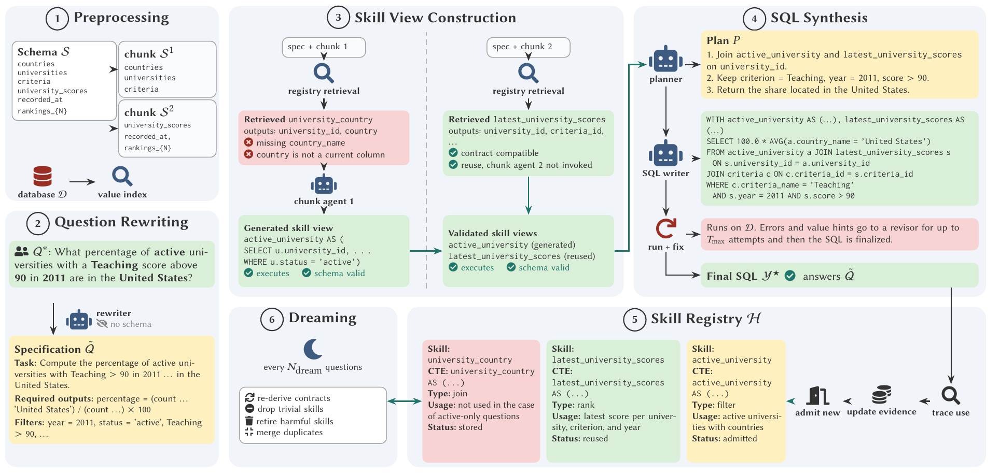

# SkiewSQL

Official code for **SkiewSQL: Skill-Driven Agentic Views for Complex and Recurring Questions in Text-to-SQL**.

SkiewSQL handles large schemas by generating and validating CTE-based skill views from schema chunks. It stores reusable SQL definitions and contracts in a per-database indexed registry, then retrieves matching skills for future questions. The paper evaluates SkiewSQL on six Text-to-SQL benchmarks.



## 1. What is included

- Schema compression, schema chunking, and database-value indexing.
- Question rewriting and chunk-level skill-view generation.
- All-or-nothing execution and schema validation for a candidate containing one or more CTEs.
- Final planning, SQL synthesis, execution repair, and optional semantic revision.
- One persistent `SkillRegistry` per database, with indexes over category, source table, output column, grain, SQL hash, and semantic description.
- The paper's `index → filter → rank → verify` retrieval path.
- SQLite runners for Spider and BIRD, plus backend-specific runners for BEAVER, Spider 2.0-Snow, and ScienceBenchmark.
- KaggleDBQA preprocessing assets. Its paper-aligned end-to-end runner is not yet implemented in this repository.
- Deterministic unit tests and a network-free demonstration.

## 2. Create the environment

Python 3.10 or 3.11 is recommended.

```bash
conda create -n skiewsql python=3.11 -y
conda activate skiewsql
python -m pip install --upgrade pip
python -m pip install -r requirements.txt
python -m pip install -e .
```

The full requirements include all supported database backends and local embedding dependencies. The CPU smoke run does not need API credentials.

## 3. Configure datasets

The paper evaluates exactly six benchmarks. Dataset releases are not redistributed in this repository. Download them from the official sources below and follow each project's access and license terms.

| Dataset | Official download/setup | Local destination used here | Notes |
|---|---|---|---|
| Spider 1.0 | [Spider project and data](https://yale-lily.github.io/spider) | `data/spider/` | Download and extract the official archive. |
| BIRD | [BIRD-SQL project and downloads](https://bird-bench.github.io/) | `data/bird/dev/` | Download the development split and databases. |
| KaggleDBQA | [Chia-Hsuan-Lee/KaggleDBQA](https://github.com/Chia-Hsuan-Lee/KaggleDBQA) | `data/kaggledbqa/` | Clone the official repository. The current code retains preprocessing assets but still lacks the paper-aligned end-to-end runner. |
| ScienceBenchmark | [official dataset page](https://sciencebenchmark.cloudlab.zhaw.ch/) | `data/sciencebenchmark/` | Download the public development data and PostgreSQL dumps from the dataset link. |
| BEAVER | [beaverbench/beaver](https://github.com/beaverbench/beaver) | `data/beaver/` | The dataset is gated. Authenticate with Hugging Face and use the upstream downloader and MySQL setup. |
| Spider 2.0-Snow | [xlang-ai/Spider2](https://github.com/xlang-ai/Spider2) | `data/spider2/` | Clone the repository and configure Snowflake using the upstream instructions. The paper evaluates only the Snowflake subset. |

The links are landing pages rather than mirrored archives so access instructions and revised releases remain visible. After downloading, use this layout for the six paper benchmarks:

```text
data/
├── spider/
│   ├── dev.json
│   ├── tables.json
│   └── database/<db_id>/<db_id>.sqlite
├── bird/dev/
│   ├── dev.json
│   ├── dev_tables.json
│   └── dev_databases/<db_id>/<db_id>.sqlite
├── kaggledbqa/
├── beaver/
├── sciencebenchmark/
└── spider2/
```

The main path overrides are:

```bash
export SKIEW_DATA_ROOT=/path/to/data
export SPIDER_ROOT=/path/to/spider
export BIRD_DEV_ROOT=/path/to/bird/dev
export BEAVER_ROOT=/path/to/beaver
export SCIENCE_ROOT=/path/to/sciencebenchmark
export SPIDER2_ROOT=/path/to/Spider2
```

For Spider and BIRD, retain the upstream directory and file names shown above. `SPIDER2_ROOT` points to the root of the cloned official repository, not its `spider2-lite/` child. Backend-specific connection variables are documented in the corresponding runner, for example `BEAVER_MYSQL_HOST`, `BEAVER_MYSQL_PORT`, `BEAVER_MYSQL_USER`, and `BEAVER_MYSQL_PASS`.

## 4. Configure the model provider

OpenAI is the default chat and embedding provider:

```bash
export OPENAI_API_KEY=...
export SKIEW_LLM_PROVIDER=openai
```

The runner also supports OpenAI-compatible Together, OpenRouter, and local Ollama endpoints through `SKIEW_LLM_PROVIDER`. Provider-specific model and credential variables are defined in `skiewsql/llm.py`. Do not place credentials in YAML files or commit a `.env` file.

## 5. Run the pipeline

Run one database stream from Spider:

```bash
python -m skiewsql.realrun \
  --dataset spider \
  --dbs top:4 \
  --limit 30 \
  --model gpt-5-mini \
  --architecture nx1 \
  --skill_registry 1 \
  --configs A \
  --tag paper
```

`--architecture nx1` is the paper path. Every compressed schema chunk receives the rewritten question and contributes at most one candidate. A candidate may contain several dependent CTEs, but the entire CTE program is validated and stored as one `ViewSpec`. `--configs A` keeps the per-database registry across the question stream. `B` is the no-memory baseline and `C` disables the compatibility guard.

Run records are written under `skiewsql/results_real/runs/`. Reusable registry JSON and readable Markdown skill cards are written under `skiewsql/results_real/registries/grown/` unless an output override is supplied.

### Candidate count

The default final synthesis is single-candidate (`K=1`). `--self_consistency N` requests independently derived final candidates when an experiment needs semantic revision and execution-result voting. Skill generation is still performed once per chunk.

## 6. How the registry works

Each database `D` owns one registry `H_D`. Its canonical record is `ViewSpec`:

```text
SQL body, category, source tables, output columns, grain, filters,
dependencies, description and use guidance, identity and version,
validation record, provenance, and reuse evidence.
```

No executed rows are part of this record. On admission, the implementation derives the contract from SQL and the live database, validates it, computes `sql_hash` and `skill_id`, deduplicates it, and updates the structural indexes.

For a later question, retrieval proceeds as follows:

1. **Index:** intersect the category, required-output, grain, and source-table index entries.
2. **Filter:** reject another database or dialect, stale schemas, missing dependencies, incompatible filters, unsafe aggregation, or the wrong grain.
3. **Rank:** score the remaining descriptions and contract overlap, adjusted by prior reuse evidence.
4. **Verify:** select a guaranteed match or abstain. Abstention sends the chunk to fresh generation.

For example, lookups for `RANK`, `university_scores`, `university_id`, `criteria_id`, `year`, and `score` may each return many IDs. Their intersection produces a small candidate set. The full `ViewSpec` is then checked to distinguish “latest score” from “highest score” or “average score.” Index overlap alone never authorizes reuse.

## 7. Run everything from one script

The default command runs all tests and the local, network-free end-to-end demonstration:

```bash
bash scripts/run_all.sh
```

Other modes and controls:

```bash
MODE=test bash scripts/run_all.sh

MODE=full \
DATASETS="spider bird" \
DBS=top:4 \
LIMIT=30 \
MODEL=gpt-5-mini \
ARCHITECTURE=nx1 \
CONFIGS=A \
bash scripts/run_all.sh
```

Full mode requires the configured datasets and model credentials. Runs are sequential within each database because a later question can reuse only skills admitted by earlier successful questions.

## 8. Tests and repository map

```bash
python -m pytest -q
```

```text
templates/                     plain-text prompts grouped by calling module
skiewsql/prompt_loader.py      safe cached template loader
skiewsql/agents.py             rewriting, generation, planning, and verification logic
skiewsql/avsql_prep.py         schema compression, chunking, and value indexing
skiewsql/core.py               ViewSpec and the flat per-database SkillRegistry
skiewsql/contracts.py          contract derivation and execution assertions
skiewsql/registry.py           indexed retrieval, admission, and reuse evidence
skiewsql/sqlview.py            validation and registry JSON/Markdown persistence
skiewsql/realrun.py            sequential Spider/BIRD experiment driver
skiewsql/*_method.py           backend-specific benchmark drivers
scripts/run_all.sh             test, smoke, and full entry point
tests/                         deterministic unit and integration tests
```

The former top-level `av_sql/` prototype was consolidated rather than shipped as a second pipeline. Its maintained schema compression, chunking, and value-indexing pieces live in `skiewsql/avsql_prep.py`. Model calls, agents, execution validation, and orchestration use the corresponding `skiewsql/` modules listed above. Obsolete graph, Cassandra, duplicate agent, and duplicate entry-point implementations were not retained.

### Where prompts are stored

Prompts are plain UTF-8 text files under the repository-level `templates/` directory. Python modules load them through `skiewsql/prompt_loader.py`. Prompt bodies are not embedded in agent code.

| Prompt group | Maintained location |
|---|---|
| Main pipeline: rewrite, decomposition/alignment, N×1 view generation, planning, composition, repair, semantic review, retrieval verification, and skill extraction | `templates/agents/` |
| MySQL/BEAVER SQL generation and repair | `templates/beaver_method/` |
| Snowflake SQL generation and repair | `templates/sf_method/` |
| PostgreSQL/ScienceBenchmark SQL generation and repair | `templates/science_method/` |
| Skill description, structure inference, and review | `templates/skillify/` |
| Table descriptions and table selection | `templates/table_catalog/` |
| Spider 2.0-Snow backend probe | `templates/spider2sf/` |

The main prompt version recorded in run metadata is derived from the loaded main-pipeline templates. The removed `prompt_templates/` tree belonged to the retired prototype and is unrelated to this maintained `templates/` directory.

## 9. Reproducibility notes

- Process questions in dataset order within each database.
- Keep one registry per database. Never retrieve across databases without explicit porting and revalidation.
- A failed final answer does not promote exploratory candidates.
- A partially valid multi-CTE candidate is discarded as a whole.
- Registry JSON contains definitions and metadata only. Query results remain in the database.
- Record the model, provider, prompt version, dataset revision, command, and random seed with results.

## License

Released under the [MIT License](LICENSE).

## Acknowledgements

The implementation builds on ideas and public resources from AV-SQL, CHESS, Alpha-SQL, ReFoRCE, MAC-SQL, DSR-SQL, Spider, BIRD, Spider 2.0, BEAVER, and ScienceBenchmark.
