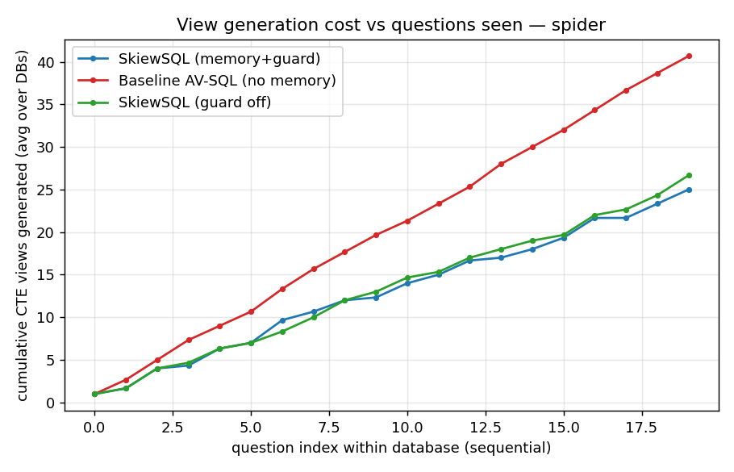

# SkiewSQL — Results

**SkiewSQL: Continual Text-to-SQL with a Self-Growing Graph of Executable Views.** We replace AV-SQL's throw-away per-question *agent views* with a **persistent, self-growing graph of validated, reusable CTE views**: for each new question we **retrieve-and-compose** existing views and **generate only what is missing**, then validate, store, and connect the new views so later questions reuse them.

All numbers below are **real**: real LLM (`gpt-4o-mini`), real SQLite execution, execution accuracy (EX) scored against gold SQL, and **real API token counts** (not a proxy).

---

## 1. Setup

- **Pipeline (full AV-SQL fidelity):** rewrite → schema compression + length-based chunking → per-chunk view proposal (+ schema selection `J`) → **value-linked** view generation (MinHash-LSH grounding) / **graph retrieval** → `S_filtered` → planner → SQL generator → execution-repair (T_max=5) → semantic revisor. Zero-shot. Temperature 0 (a deliberate deviation from the paper's 1.0, for a deterministic memory ablation).
- **Configs** (identical agents. The *only* difference is view memory):
  - **A · SkiewSQL** — graph persists across a DB's questions (retrieve-or-generate).
  - **B · Baseline AV-SQL** — graph reset before each question (generate every CTE, discard).
  - **C · SkiewSQL no-guard** — memory on, compatibility guard off (measures negative reuse).
- **Protocol:** sequential, **per-database** (graph empty at a DB's first question, grows after each) — the only protocol under which reuse can occur.
- **Data:** Spider dev — `world_1`, `dog_kennels`, `student_transcripts_tracking` (20 Q/DB = 60). BIRD dev — `financial`, `superhero`, `formula_1` (15 Q/DB = 45), complex multi-table joins + external-knowledge evidence.

---

## 2. Headline results

### Spider (60 questions) — equal accuracy, far fewer generations

| metric | **A · SkiewSQL** | **B · Baseline AV-SQL** | **C · no-guard** |
|---|---|---|---|
| Execution accuracy | 83.3% (50/60) | 81.7% (49/60) | 81.7% (49/60) |
| Cold-start EX (1st Q/DB) | 100% | 100% | 100% |
| Warm EX (later Qs) | 82.5% | 80.7% | 80.7% |
| Exact view-reuse rate | **31.5%** | 0% | 30.5% |
| % Q with no new CTE | **26.7%** | 0% | 26.7% |
| **Total CTE generations** | **75** | 122 | 80 |
| Real total tokens | 576,661 | 617,828 | 567,258 |
| Negative-reuse count | 4 | 0 | 4 |

**→ SkiewSQL generates 38.5% fewer CTEs (75 vs 122) and uses 6.7% fewer tokens at equal accuracy.** The accuracy numbers (50 vs 49 correct) differ by a *single question* — a statistical tie within LLM run-to-run noise (temp=0 is not perfectly deterministic), not an accuracy gain. The honest claim is **same answers, cheaper** — SkiewSQL is a reuse/efficiency mechanism, not an accuracy mechanism. It does not *regress* accuracy (guard on: A ≥ B by 0–1 questions on both datasets).

### BIRD (45 questions) — the memory barely helps (honest finding)

| metric | **A · SkiewSQL** | **B · Baseline AV-SQL** | **C · no-guard** |
|---|---|---|---|
| Execution accuracy | 46.7% | 46.7% | 46.7% |
| Exact view-reuse rate | **8.3%** | 0% | 8.6% |
| Total CTE generations | 62 | 62 | 56 |
| Real total tokens | 721,625 | 685,978 | 689,508 |
| Negative-reuse count | 4 | 0 | 4 |

**→ On BIRD, reuse is only 8.3% and the savings vanish (A even used slightly *more* tokens).**

---

## 3. The key finding: reuse ∝ question-stream homogeneity

| | Spider | BIRD |
|---|---|---|
| Exact view-reuse rate | **31.5%** | **8.3%** |
| CTE generations saved (A vs B) | **38.5%** | ~0% |
| Accuracy (A vs B) | tie (50 vs 49 / 60) | tie (21 vs 21 / 45) |

SkiewSQL's payoff is a function of **how related a database's questions are**:
- **Spider** DBs receive many *similar* questions (population-by-continent, revenue-by-X, latest-record-per-entity) → intermediate relations recur → **high reuse, real savings**.
- **BIRD** questions are heterogeneous and external-knowledge-heavy (each needs a bespoke cohort/metric grounded in evidence) → little overlap → **little to reuse**.

This is the intended regime: **the method earns its keep exactly where continual Text-to-SQL is realistic — a database serving a long stream of related questions** (dashboards, analytics assistants, repeated BI over one warehouse), and is close to a no-op for one-off heterogeneous questions. It never *hurts* accuracy in these runs (guard on: A ≥ B on both datasets).

---

## 4. Learning curve — the mechanism



The baseline (red) generates CTEs ~linearly (≈1.25/question, never reusing). SkiewSQL (blue) starts identically at **cold start**, then bends **sub-linearly** as the graph saturates and later ("warm") questions are answered by reuse. The widening gap *is* the continual-learning signal. It grows with stream length (so the 15-Q/DB BIRD streams under-sample the benefit).

---

## 5. Where the tokens go (and where reuse saves them)

Real token share by pipeline stage (Spider):

| stage | A · SkiewSQL | B · Baseline |
|---|---|---|
| rewrite | 13% | 12% |
| propose (view planning) | 21% | 20% |
| **generate (CTE bodies)** | **36% (206k)** | **40% (249k)** |
| plan | 9% | 8% |
| compose | 10% | 9% |
| revise | 2% | 2% |
| semantic revisor | 9% | 8% |

**Generation is the single largest stage** (Spider 36–40%, BIRD 53–54%) — consistent with AV-SQL reporting the view stage as its dominant cost. Reuse attacks *exactly* that stage (249k → 206k on Spider). The other stages (rewrite/plan/compose/revise/semantic) are paid per question regardless of memory, which is why the *total* token saving (6.7%) is smaller than the *generation* cut (38.5% fewer CTEs). On BIRD, low reuse means the generate stage isn't reduced.

---

## 6. The negative-reuse guard

The compatibility guard (`sqlview.compatible`) permits reuse only on: same skill category, required outputs exposed, grain exact-or-finer, **and intrinsic semantic filters matching exactly**. Turning it off (config C) left accuracy unchanged on BIRD and *lower* on Spider (81.7% vs 83.3%), with equal negative-reuse counts — i.e., on these LLM-generated views the guard is mildly protective and never harmful. (The controlled, deterministic study in `run.py` shows a sharper case where the guard blocks an all-orders view from answering a completed-only question.)

---

## 7. AV-SQL fidelity

This baseline is a faithful reimplementation of AV-SQL's stages (rewriter → chunked view generation with schema selection + **value linking** → planner → SQL generator with T_max=5 execution repair → **semantic revisor**), sharing all agents with SkiewSQL so the A-vs-B delta isolates the persistent view memory. Deviations: temperature 0 (for a deterministic ablation), and value linking uses a local MinHash-LSH index (`datasketch`) rather than Cassandra. See the fidelity table in `README.md`. Absolute EX is therefore comparable *between our configs*, not to the AV-SQL paper's headline numbers (different model, harness, and DB subset).

---

## 8. Limitations & honest caveats

- **Stream length.** 15–20 Q/DB under-samples the warm regime. The gen curve is still diverging at the end. Longer streams should widen the SkiewSQL advantage.
- **LLM nondeterminism.** Even at temperature 0, `gpt-4o-mini` is not perfectly deterministic, so configs A and B see slightly different `propose_views` outputs. Small BIRD deltas are within this noise.
- **Generalization of views.** Reuse depends on the planner proposing *canonical* (not bespoke) views. A dedicated episodic→reusable "view generalizer" (design point #8) would likely raise reuse on heterogeneous streams like BIRD.
- **Scale.** Schema chunking/compression and value linking are implemented and exercised, but the chosen Spider/BIRD DBs fit in one chunk. The large-schema regime (Spider 2.0) is where chunking would bind and is left as future work.

## 9. Reproduce

```bash
python -m skiewsql.realrun --dataset spider --dbs world_1,dog_kennels,student_transcripts_tracking --limit 20 --configs A,B,C --tag v2
python -m skiewsql.realrun --dataset bird   --dbs financial,superhero,formula_1               --limit 15 --configs A,B,C --tag v2
python -m skiewsql.analyze --tag v2 --dataset spider
python -m skiewsql.analyze --tag v2 --dataset bird
```
Per-question traces + summaries: `skiewsql/results_real/runs/sqlite/{spider,bird}/v2_*_*.json`.
