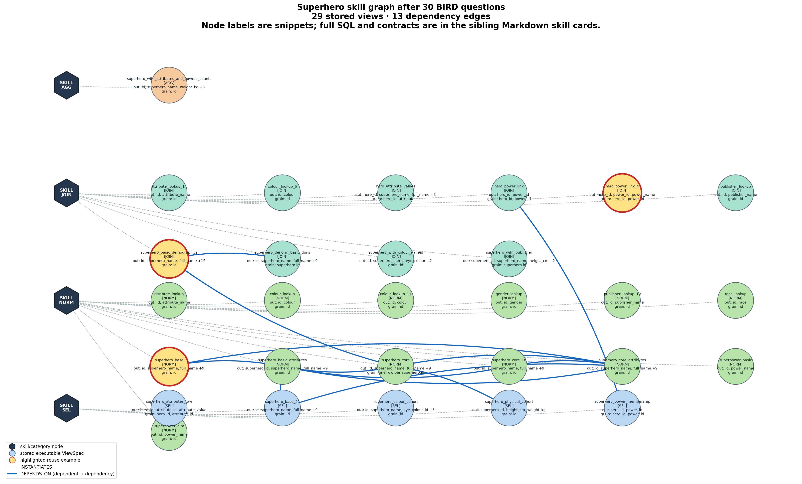
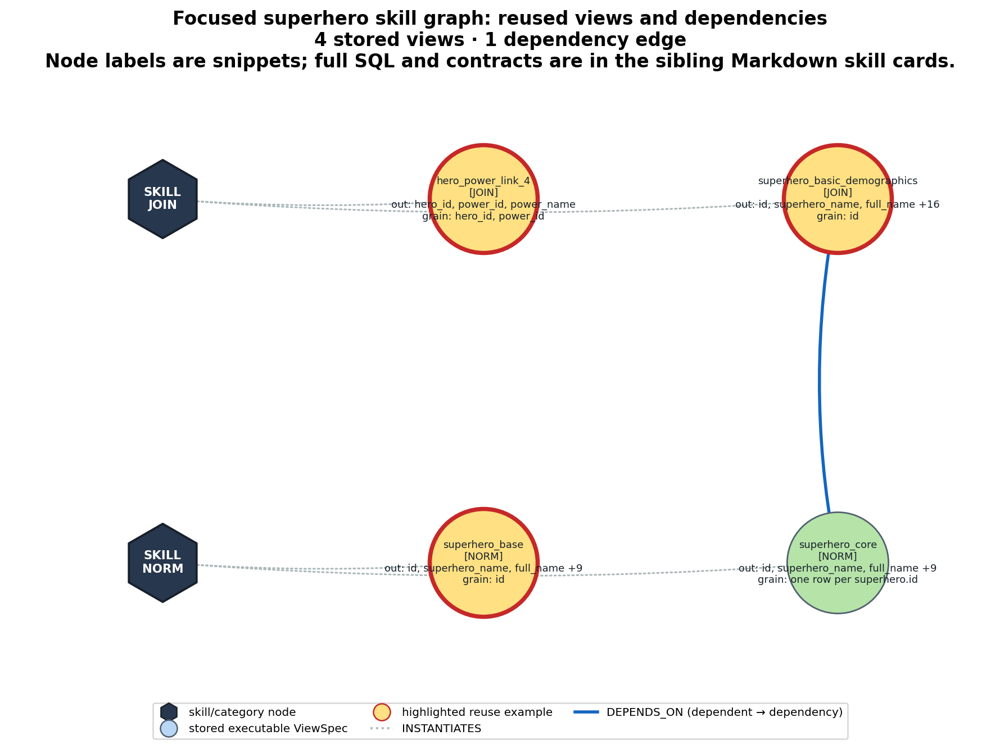

# AV-SQL N×1: why the graph run scored 11/17 and the no-graph run scored 7/17

This note explains the four questions whose saved result changed from wrong in the no-graph run to correct in the graph run. It is written for a student who has not seen AV-SQL, CTEs, schema chunks, or view-memory graphs before.

## The most important conclusion

The four questions are **paired accuracy improvements**, but they are **not four demonstrated cases where reuse caused the improvement**.

| Question | No graph | Graph | Did retrieval fire? | Did the reused CTE compute the answer? |
|---|---:|---:|---:|---|
| `spider_dev_507`: address lines | Wrong | Correct | No | No graph existed yet |
| `spider_dev_509`: total courses | Wrong | Correct | Yes | No. An address CTE was unused |
| `spider_dev_510`: number of courses | Wrong | Correct | Yes | No. An address CTE was unused |
| `spider_dev_513`: Port Chelsea zip code | Wrong | Correct | Yes | No. The final SQL omitted the CTE |

Thus, the honest interpretation is:

- the graph run happened to be correct on four questions where the independently generated no-graph run was wrong.
- one improvement occurred with an empty graph.
- the other three runs retrieved a CTE, but their correct final answers came from fresh SQL over the base tables.
- these traces do **not** isolate a causal accuracy benefit from graph reuse.

They do show a real efficiency effect: after the first question, the graph arm generated no new CTEs for this 10-question Spider stream. However, they also expose unsafe retrieval and incorrect credit assignment.

## 1. What was compared?

The 17-question pilot contained:

- 10 Spider questions from `student_transcripts_tracking`.
- 5 BIRD questions.
- 2 Spider2-lite questions.

For AV-SQL N×1:

- no graph: **7/17 correct**.
- graph: **11/17 correct**.

All four differences came from Spider. The BIRD and Spider2-lite correctness counts did not change. The Spider no-graph run scored 6/10. The graph run scored 10/10.

The raw files are:

- [no-graph AV-SQL results](runs/arch10_nx1_spider_B_Baseline_AVSQL.json).
- [graph AV-SQL results](runs/mem_arch10_nx1_spider_A_SkiewSQL.json).
- [final graph as a readable skill graph](graphs/grown/mem_arch10_nx1_spider_A_SkiewSQL/student_transcripts_tracking.md).
- [final graph as JSON](graphs/grown/mem_arch10_nx1_spider_A_SkiewSQL/student_transcripts_tracking.json).

Both runs used local Ollama `gemma3:4b`, temperature 0, a 1,000-token chunk budget, one SQL-repair attempt, one view-validation attempt, and the same ordered questions.

### Reproducibility limitation

The result JSON saves the question, final SQL, correctness, retrieval diagnostics, reused names, and generation counts. It does **not** save the original question-rewrite text, planner text, or every pre-repair SQL candidate.

The rewrites below were regenerated later with the same rewrite prompt and model. They are faithful reconstructions, but not guaranteed byte-for-byte copies of the original run. The final SQL, CTE bodies, similarities, and result sets are taken directly from saved artifacts or re-executed against the same database.

## 2. Beginner's explanation of AV-SQL N×1

### Schema chunk

A database schema lists tables and columns. If the schema is too long for one model prompt, the runner divides it into `N` chunks. This experiment had `N = 2`.

### N×1

`N×1` means that the complete rewritten question is sent once to each of the `N` chunks. It does not decompose the question into multiple subgoals.

For every question here, AV-SQL created two requests:

```text
chunk_view_0 = complete question applied to schema chunk 0
chunk_view_1 = complete question applied to schema chunk 1
```

### CTE

A Common Table Expression is a temporary named query:

```sql
WITH some_name AS (
  SELECT ...
)
SELECT ... FROM some_name;
```

AV-SQL asks each chunk agent to propose one CTE. A later planner combines the valid CTEs into the final SQL.

### Graph and reuse

With no graph, the system generates new CTEs for every question.

With a graph, a validated CTE is stored after a question. Before generating a new CTE, the system searches earlier stored CTEs. Retrieval uses:

1. a structural compatibility check. And
2. embedding similarity between the new request and the stored CTE description.

The threshold in this experiment was 0.55.

### Three different meanings of “used”

These must not be confused:

1. **Retrieved:** the graph returned a CTE to the planner.
2. **Included:** the CTE appeared in the final SQL's `WITH` clause.
3. **Causally used:** the final `SELECT` actually read from that CTE and relied on its rows.

The saved field `used_reuse` currently records the first meaning: `reused > 0`. It does not prove the third. This distinction is central to the examples below.

## 3. The two schema chunks

The schema was partitioned deterministically under the 1,000-token budget.

### Chunk 0: 969 tokens

Tables:

```text
Addresses
Courses
Departments
Degree_Programs
Sections
Semesters
Students
```

The relevant definitions for the four questions were:

```sql
CREATE TABLE "Addresses" (
    "address_id" INTEGER PRIMARY KEY,
    "line_1" VARCHAR(255),
    "line_2" VARCHAR(255),
    "line_3" VARCHAR(255),
    "city" VARCHAR(255),
    "zip_postcode" VARCHAR(20),
    "state_province_county" VARCHAR(255),
    "country" VARCHAR(255),
    "other_address_details" VARCHAR(255)
);

CREATE TABLE "Courses" (
    "course_id" INTEGER PRIMARY KEY,
    "course_name" VARCHAR(255),
    "course_description" VARCHAR(255),
    "other_details" VARCHAR(255)
);
```

### Chunk 1: 419 tokens

Tables:

```text
Student_Enrolment
Student_Enrolment_Courses
Transcripts
Transcript_Contents
```

Chunk 1 was irrelevant to the address questions. It could look superficially relevant to course questions because `Student_Enrolment_Courses` contains `course_id`, but the questions ask how many course records are listed, so the correct source is `Courses` in chunk 0.

## 4. What entered the graph on the first question?

The graph began empty. The first graph-run question generated and validated two CTEs.

### Stored `chunk_view_0`

```sql
SELECT
  "Addresses"."line_1",
  "Addresses"."line_2"
FROM "Addresses"
```

Description:

```text
Task: Retrieve all addresses, including the line 1 and line 2 address components.
Required outputs: The complete address, consisting of line 1, line 2, and any other relevant address information.
```

### Stored `chunk_view_1`

```sql
SELECT
    T."other_details"
FROM Transcripts AS T
```

The second CTE is not semantically useful for an address question. Nevertheless, it passed SQL execution validation because it is valid SQL. Execution validation proves that a CTE runs. It does not prove that it answers the intended question.

For all later questions, retrieval selected `chunk_view_0`. Because N×1 makes two requests, the same stored CTE was returned once for `chunk_view_0` and again for `chunk_view_1`.

## 5. Case 1 — `spider_dev_507`: address lines

### 5.1 Question and correct meaning

Question:

> what are all the addresses including line 1 and line 2?

Gold SQL:

```sql
SELECT line_1, line_2
FROM Addresses;
```

The database has 15 addresses. The correct answer therefore has 15 rows and exactly 2 columns.

### 5.2 Reconstructed question rewrite

```text
Task: Retrieve all addresses, including the line 1 and line 2 address components.
Required outputs: A record containing the address line 1, address line 2, and the entire address.
```

The phrase “entire address” is slightly ambiguous. It helps explain why one run returned extra address columns.

### 5.3 No-graph run, step by step

1. The runner rewrote the question.
2. It created one whole-question request for chunk 0 and one for chunk 1.
3. With memory disabled, it generated two new CTEs.
4. Both were handed to the planner.
5. The saved final SQL was:

```sql
SELECT
  A."line_1",
  A."line_2",
  A."city",
  A."zip_postcode",
  A."state_province_county",
  A."country"
FROM Addresses AS A;
```

6. This query returned 15 rows but 6 columns.
7. Spider execution matching expected only `(line_1, line_2)`, so the answer was wrong.

The mistake was output arity: the model interpreted “all the addresses” as “return most address fields,” rather than “return every row, with the two requested fields.”

### 5.4 Graph run, step by step

1. This was the first question, so the graph was empty.
2. Both retrieval diagnostics said `no candidate in graph` with similarity 0.0.
3. The system generated the two CTEs shown in Section 4.
4. The planner selected only `line_1` and `line_2` from the address CTE:

```sql
WITH chunk_view_0 AS (
  SELECT "Addresses"."line_1", "Addresses"."line_2"
  FROM "Addresses"
),
chunk_view_1 AS (
  SELECT T."other_details"
  FROM Transcripts AS T
)
SELECT "line_1", "line_2"
FROM chunk_view_0;
```

5. This returned exactly the same 15 two-column rows as the gold query.

### 5.5 Was the graph responsible?

No. There was no previous CTE to reuse. The graph-run model simply generated a better projection in this independent run. This is run-to-run model variation, not graph assistance.

This first correct query then created the address CTE that was retrieved later.

## 6. Case 2 — `spider_dev_509`: total courses

### 6.1 Question and schema

Question:

> How many courses in total are listed?

Relevant schema:

```text
Courses.course_id — primary key
Courses.course_name
Courses.course_description
Courses.other_details
```

Gold SQL:

```sql
SELECT COUNT(*)
FROM Courses;
```

There are 15 rows in `Courses`, so the correct result is `15`.

### 6.2 Reconstructed rewrite

```text
Task: Calculate the total number of courses listed in the database.
Required outputs: The total count of courses.
```

### 6.3 No-graph run, step by step

1. N×1 created two whole-question requests.
2. Only one newly generated CTE survived validation.
3. That CTE already aggregated the courses into one row:

```sql
WITH chunk_view_0 AS (
  SELECT COUNT(T1.course_id)
  FROM Courses AS T1
)
```

4. The final planner then counted the rows of this one-row CTE:

```sql
SELECT COUNT(*)
FROM chunk_view_0;
```

5. The inner query produced one row containing `15`.
6. The outer query counted that one row and returned `1`.
7. Gold returned `15`, so the prediction was wrong.

This is a classic **double-aggregation/grain error**. After the inner `COUNT`, the CTE grain is one summary row. Counting summary rows is not the same as counting courses.

### 6.4 Graph run, step by step

1. The graph contained the address CTE created by question 507.
2. Both chunk requests retrieved that same CTE:

```text
retrieved name: chunk_view_0
similarity: 0.634
number of retrieval hits: 2
```

3. The retrieved CTE was:

```sql
SELECT Addresses.line_1, Addresses.line_2
FROM Addresses;
```

4. This CTE has no `course_id` and cannot count courses.
5. The final SQL included it syntactically but did not read from it:

```sql
WITH chunk_view_0 AS (
  SELECT "Addresses"."line_1", "Addresses"."line_2"
  FROM "Addresses"
)
SELECT COUNT(DISTINCT course_id)
FROM Courses;
```

6. `course_id` is a primary key, so all 15 values are distinct.
7. `COUNT(DISTINCT course_id)` therefore returned `15`, matching gold.

### 6.5 How did the model aggregate correctly?

The correct aggregation was performed directly on `Courses`:

```text
Courses rows
   ↓ take course_id
15 unique primary-key values
   ↓ COUNT(DISTINCT ...)
15
```

The address CTE contributed no rows or columns to this computation.

### 6.6 Why did graph beat no graph here?

In the saved pair, graph was correct and no graph was wrong. But the mechanism was not useful reuse:

- no graph generated a plausible CTE and then counted the CTE's single summary row.
- graph retrieved an irrelevant CTE.
- the graph-run final planner ignored that CTE and independently wrote the correct base-table count.

The safest conclusion is that avoiding new CTE generation changed the planner context and happened to avoid double aggregation. This is a hypothesis about prompt/context effects, not proof that the stored skill supplied the answer.

## 7. Case 3 — `spider_dev_510`: number of courses

### 7.1 Question, schema, and rewrite

Question:

> How many courses are there?

The schema and gold answer are identical to Case 2. Gold is again:

```sql
SELECT COUNT(*) FROM Courses;
```

Reconstructed rewrite:

```text
Task: Calculate the total number of courses in the database.
Required outputs: The total count of courses.
```

### 7.2 No-graph run, step by step

1. The chunk-0 agent generated a one-row course count:

```sql
chunk_view_0 AS (
  SELECT COUNT(T1.course_id)
  FROM Courses AS T1
)
```

2. The chunk-1 agent generated another aggregate over enrolled courses:

```sql
chunk_view_1 AS (
  SELECT COUNT(DISTINCT s.course_id)
  FROM Student_Enrolment_Courses AS s
)
```

3. The final planner chose `chunk_view_0` but again counted its rows:

```sql
SELECT COUNT(*)
FROM chunk_view_0;
```

4. `chunk_view_0` has one summary row, so the result was `1` rather than `15`.

The second CTE was also conceptually risky: it counts courses appearing in enrolments, which need not equal the number of course records listed in `Courses`.

### 7.3 Graph run, step by step

1. Both N×1 requests again retrieved the address-line CTE.
2. Similarity was 0.632, just above the 0.55 threshold.
3. The final SQL was:

```sql
WITH chunk_view_0 AS (
  SELECT "Addresses"."line_1", "Addresses"."line_2"
  FROM "Addresses"
)
SELECT COUNT(course_id)
FROM Courses;
```

4. The `WITH` clause is present, but the final `SELECT` reads only `Courses`.
5. Every course row has a non-null primary key, so `COUNT(course_id)` returned `15`.

### 7.4 How did the model aggregate correctly?

```text
Courses table: 15 rows
   ↓ course_id is non-null for every row
COUNT(course_id)
   ↓
15
```

Again, the reused CTE was not part of the dataflow.

## 8. Case 4 — `spider_dev_513`: Port Chelsea zip code

### 8.1 Question and schema

Question:

> What is the zip code of the address in the city Port Chelsea?

Relevant columns:

```text
Addresses.address_id
Addresses.city
Addresses.zip_postcode
```

The database row is:

```text
city = Port Chelsea
zip_postcode = 148
```

Gold SQL:

```sql
SELECT zip_postcode
FROM Addresses
WHERE city = 'Port Chelsea';
```

### 8.2 Reconstructed rewrite

```text
Task: Retrieve the zip code associated with the address located in Port Chelsea.
Required outputs: The zip code of the address.
Filters: The address must be located in the city of Port Chelsea.
```

### 8.3 No-graph run, step by step

1. The chunk-0 CTE correctly filtered the base table, but projected only the zip code:

```sql
chunk_view_0 AS (
  SELECT T1.zip_postcode
  FROM Addresses AS T1
  WHERE T1.city = 'Port Chelsea'
)
```

2. The chunk-1 CTE searched transcript details for `Port Chelsea`, which was irrelevant.
3. The final planner redundantly tried to apply the city filter again:

```sql
SELECT "zip_postcode"
FROM chunk_view_0
WHERE "city" = 'Port Chelsea';
```

4. But `chunk_view_0` exposes only `zip_postcode`. It does not expose `city`.
5. Under this SQLite build, the unresolved double-quoted token behaves like the string literal `'city'`, making the condition effectively `'city' = 'Port Chelsea'`.
6. That condition is false, so the query returned zero rows.
7. Gold returned one row, `148`, so the prediction was wrong.

The design lesson is that a downstream planner cannot reapply a filter on a column that the CTE did not carry forward. Either the planner should trust the CTE's existing filter, or the CTE should expose `city` as well as `zip_postcode`.

### 8.4 Graph run, step by step

1. Both requests retrieved the original address-line CTE.
2. Similarity was 0.713.
3. That CTE exposes `line_1` and `line_2`, not `city` or `zip_postcode`, so it cannot answer the new question.
4. The saved final SQL contains no `WITH` clause at all:

```sql
SELECT T1.zip_postcode
FROM Addresses AS T1
JOIN Addresses AS T2
  ON T1.address_id = T2.address_id
WHERE T2.city = 'Port Chelsea';
```

5. The self-join matches each address to itself using the primary key.
6. The filter keeps the Port Chelsea row.
7. The projection returns its zip code, `148`.

The self-join is unnecessary. A simpler equivalent is the gold SQL. Nevertheless, it is correct.

### 8.5 Did the reused CTE help?

No direct evidence says it did. Retrieval fired and the CTE was handed to the planner, but the final executable SQL does not contain or reference it. The correct answer came from a fresh base-table query, possibly after final-query repair.

## 9. Why did retrieval choose an address CTE for course questions?

AV-SQL N×1 requests have broad contracts in this implementation:

```text
category = SEL
required outputs = empty
grain = empty
semantic filters = empty
```

The stored address CTE has the same broad empty contract. Therefore, the structural guard finds it compatible with almost any later whole-question request. The embedding scores then exceed 0.55:

```text
course total question: 0.634
course count question: 0.632
Port Chelsea zip question: 0.713
```

This is why the graph returns the address projection even when the new question concerns `Courses`. The view's actual output columns are empty in its stored contract, even though the SQL visibly emits `line_1` and `line_2`. The guard therefore cannot compare the real outputs required by the request.

## 10. Incorrect graph credit assignment

The final graph says the address skill was `validated_on` the two course-count questions and the zip question. That is misleading:

- the final answer was correct.
- a retrieval had fired.
- the learning step credited the retrieved view.
- but the final SQL did not depend on that view.

This is a credit-assignment problem. A stored view should be marked validated only if the final SQL actually references it and its output participates in the result.

## 11. What genuinely went wrong without the graph?

The no-graph errors are concrete and useful:

| Question | No-graph failure |
|---|---|
| Address lines | Returned six address columns instead of exactly two |
| Total courses | Counted the single row produced by an inner aggregate, returning 1 |
| Number of courses | Repeated the same double-aggregation error |
| Port Chelsea zip | Reapplied a filter on `city` after the CTE had dropped `city`, returning no rows |

These failures suggest three improvements independent of graph memory:

1. Give every view an explicit output-column and grain contract.
2. Make the planner reason about whether a CTE is already aggregated.
3. Ensure columns required for downstream filters are carried through the CTE, or do not reapply a filter already enforced inside the CTE.

## 12. What should be claimed from the 11/17 versus 7/17 result?

Safe claim:

> In one small, non-deterministic 17-question run, graph-enabled AV-SQL scored 11/17 while an independently generated no-graph run scored 7/17. The graph arm also reduced new CTE generation from 28 to 6 and tokens from 242,729 to 188,336.

Unsafe claim:

> Four questions became correct because the model reused previously learned CTEs.

The per-question traces reject the unsafe claim. To measure causal graph benefit, the experiment needs paired controls such as:

1. fix model sampling and seeds as tightly as the backend allows.
2. replay the same planner call with only the presence/absence of the candidate CTE changed.
3. record the exact rewrite, planner output, pre-repair SQL, post-repair SQL, and final SQL.
4. parse the final SQL to verify that a retrieved CTE is referenced.
5. optionally ablate that CTE and confirm that removing it changes the result.
6. repeat each question across multiple seeds and report confidence intervals.

Until that audit is added, this run supports an efficiency observation and identifies failure modes, but it does not establish four causal accuracy wins from graph reuse.

## 13. Are there any demonstrated graph-reuse wins?

Yes, if “win” means that all of the following are visible in the saved trace:

1. retrieval returned an earlier CTE.
2. the final SQL actually reads from that CTE in `FROM` or `JOIN`.
3. the final answer is correct. And
4. the graph run avoided regenerating at least that CTE.

There are also three stronger **accuracy-associated candidates** elsewhere in the saved experiments: the graph answer is correct, the matched no-graph answer is wrong, and a reused CTE participates in the final dataflow.

However, “graph correct and no graph wrong” still does not prove causality because the two arms made independent model calls. The following evidence levels keep that distinction explicit.

| Evidence level | Meaning |
|---|---|
| A — demonstrated functional reuse | Correct final SQL reads the reused CTE and avoids regeneration |
| B — matched accuracy-associated reuse | Level A, plus matched no-graph is wrong |
| C — isolated causal accuracy win | Holding generation fixed, removing only the reused CTE makes the answer wrong |

The current artifacts contain Level A and Level B examples. They do not contain a Level C counterfactual ablation.

### Summary of the strongest examples

| Example | Level | Graph | No graph | Reused CTE's role |
|---|---|---:|---:|---|
| Spider address paraphrase, AV-SQL N×1 | A | Correct | Correct | Supplies both requested address columns |
| Spider course-count paraphrase, dependency N×M | A | Correct | Correct | Supplies one row per course for final count |
| BIRD Marvel + Super Strength | B | Correct, 201 rows | Wrong, 200 rows | Supplies publisher labels and hero-power mapping |
| BIRD league with most 2016 draws | B | Correct, one column | Wrong, extra column | Supplies league ID-to-name lookup |
| Spider2-lite IPL batting averages | B | Correct top five | Wrong top five | Supplies player ID-to-name lookup |

The next sections trace these examples step by step.

## 14. Level A example — AV-SQL reuses the address projection

### 14.1 Question and relationship to the previous question

Current question, `spider_dev_508`:

> What is the first and second line for all addresses?

Immediately preceding question, `spider_dev_507`:

> what are all the addresses including line 1 and line 2?

These are near-paraphrases with the same gold SQL:

```sql
SELECT line_1, line_2
FROM Addresses;
```

The schema is the `Addresses` definition shown in Section 3.

Conceptual rewrite:

```text
Task: Return every address's first and second address lines.
Required outputs: line_1 and line_2.
Grain: one row per address.
```

### 14.2 What was already in the graph?

Question 507 generated:

```sql
-- chunk_view_0
SELECT
  Addresses.line_1,
  Addresses.line_2
FROM Addresses;
```

This is exactly the reusable intermediate relation needed by question 508.

### 14.3 Graph run

N×1 made one request for each of the two schema chunks. Both requests retrieved the same stored CTE:

```text
request chunk_view_0 → chunk_view_0, similarity 0.832
request chunk_view_1 → chunk_view_0, similarity 0.832
generated CTEs: 0
```

The final SQL genuinely reads from it:

```sql
WITH chunk_view_0 AS (
  SELECT
    Addresses.line_1,
    Addresses.line_2
  FROM Addresses
)
SELECT
  line_1,
  line_2
FROM chunk_view_0;
```

Dataflow:

```text
Addresses
   ↓ saved chunk_view_0 projects line_1 and line_2
chunk_view_0
   ↓ final SELECT reads both columns
15 correct address rows
```

This is different from the earlier course examples: the final `FROM chunk_view_0` proves that the reused CTE participates in the result.

### 14.4 No-graph run

The no-graph arm could not retrieve anything, so it generated two CTEs for the two chunks. Its final SQL was nevertheless simplified to a correct base-table query:

```sql
SELECT
  Addresses.line_1,
  Addresses.line_2
FROM Addresses;
```

### 14.5 Demonstrated benefit

| Metric | No graph | Graph |
|---|---:|---:|
| Correct | Yes | Yes |
| Retrieved CTEs | 0 | 2 requests satisfied by one stored CTE |
| New validated CTEs | 2 | 0 |
| Tokens | 9,705 | 5,091 |

The graph saved 4,614 tokens, or 47.5%, and avoided two generation calls' outputs while preserving the answer. This is a demonstrated graph-reuse **efficiency win**, not an accuracy win.

## 15. Level A example — dependency N×M reuses a course-row relation

This example comes from the matched dependency N×M run, not AV-SQL N×1. It shows why structured outputs and grain make reuse easier to trust.

### 15.1 Source and target questions

Source question, `spider_dev_509`:

> How many courses in total are listed?

Target question, `spider_dev_510`:

> How many courses are there?

Both mean:

```text
Count all rows in Courses.
```

Relevant schema:

```sql
CREATE TABLE Courses (
  course_id INTEGER PRIMARY KEY,
  course_name VARCHAR(255),
  course_description VARCHAR(255),
  other_details VARCHAR(255)
);
```

### 15.2 What question 509 stored

Question 509 generated this structured view:

```text
name: course_counts
output: course_id
grain: course_id — one row per course
source: Courses
```

```sql
SELECT c.course_id
FROM Courses AS c
WHERE 1 = 1;
```

The apparently redundant `WHERE 1 = 1` has no semantic effect.

### 15.3 Graph execution of question 510

1. The question was decomposed into a course-count request.
2. The compatibility guard saw that `course_counts` exposes the needed `course_id` at one-row-per- course grain.
3. Embedding similarity was 0.986.
4. The graph returned `course_counts`.
5. No new CTE was generated.
6. The final query counted its rows:

```sql
WITH course_counts AS (
  SELECT c.course_id
  FROM Courses AS c
  WHERE 1 = 1
)
SELECT COUNT(course_id)
FROM course_counts;
```

Result:

```text
15 course rows → COUNT(course_id) → 15
```

### 15.4 No-graph execution

The no-graph arm generated a new, nearly identical view:

```sql
WITH course_count AS (
  SELECT course_id
  FROM Courses
)
SELECT COUNT(DISTINCT course_id)
FROM course_count;
```

It was also correct.

### 15.5 Demonstrated benefit

| Metric | No graph | Graph |
|---|---:|---:|
| Correct | Yes | Yes |
| New CTEs | 1 | 0 |
| Tokens | 5,624 | 4,962 |

The graph saved one view generation and 662 tokens, or 11.8%. More importantly, the reused CTE has an explicit output and grain that match the target operation. This is a much cleaner reuse contract than N×1's empty output/grain contract.

## 16. Level B candidate — Marvel superheroes with Super Strength

This example comes from the matched 180-question BIRD Mini-Dev run:

- [graph results](../../runs/sqlite/bird/bmproj_bird_minidev_A_SkiewSQL.json).
- [no-graph results](../../runs/sqlite/bird/bmproj_bird_minidev_B_Baseline_AVSQL.json).
- [final superhero graph](../../graphs/grown/bmproj_bird_minidev_A_SkiewSQL/superhero.json).

### 16.1 Question and schema

Question, `birdmini_730`:

> List the superheroes from Marvel Comics who have the super power of 'Super Strength'.

Relevant schema:

```sql
superhero(id, superhero_name, publisher_id, ...)
publisher(id, publisher_name)
hero_power(hero_id, power_id)
superpower(id, power_name)
```

Conceptual rewrite:

```text
1. Find superheroes whose publisher label is 'Marvel Comics'.
2. Find hero-power associations whose power label is 'Super Strength'.
3. Join them by superhero ID.
4. Return superhero_name only, preserving one row per matching superhero record.
```

### 16.2 Earlier views available in the graph

The graph had accumulated three compatible views:

```text
superhero_base
  one row per superhero; exposes ID, name, publisher_id, and other core attributes

superhero_basic_demographics
  one row per superhero; joins superhero to publisher and other lookup labels

hero_power_link_4
  one row per hero-power association; joins hero_power to superpower
```

The important SQL bodies were:

```sql
-- superhero_basic_demographics, shortened to the relevant joins
SELECT
  s.id,
  s.superhero_name,
  p.publisher_name,
  ...
FROM superhero_core AS s
LEFT JOIN publisher AS p
  ON s.publisher_id = p.id
...;

-- hero_power_link_4
SELECT
  hp.hero_id,
  hp.power_id,
  sp.power_name
FROM hero_power AS hp
JOIN superpower AS sp
  ON sp.id = hp.power_id;
```

They were created on earlier superhero questions. For example, `hero_power_link_4` was generated while answering a question about blue-eyed heroes with the Agility power, and `superhero_basic_demographics` was generated for a Marvel-publisher ranking question.

### 16.3 Graph run, step by step

All three requests were satisfied by memory:

```text
superhero_core request      → superhero_base, similarity 0.853
superhero_publisher request → superhero_basic_demographics, similarity 0.729
hero_power_map request      → hero_power_link_4, similarity 0.890
new CTEs generated: 0
```

The final dataflow actually uses two retrieved views:

```sql
SELECT s.superhero_name
FROM superhero_basic_demographics AS s
JOIN hero_power_link_4 AS hp
  ON s.id = hp.hero_id
WHERE s.publisher_name = 'Marvel Comics'
  AND hp.power_name = 'Super Strength';
```

The full composed SQL includes the stored CTE definitions before this `SELECT`.

Execution returned 201 rows, exactly matching gold.

### 16.4 No-graph run and failure

The no-graph run generated fresh views with almost the same logical joins, but its final query used:

```sql
SELECT DISTINCT swp.superhero_name
...
```

Two different matching superhero records share the name `Atlas`. `DISTINCT` collapsed them into one row. Therefore:

```text
gold:     201 rows, including Atlas twice
graph:    201 rows, including Atlas twice
no graph: 200 rows, Atlas collapsed to one row
```

### 16.5 Evidence assessment

This is strong Level B evidence:

- graph correct, no graph wrong.
- zero new CTEs versus three.
- two reused CTEs are directly joined by the final query.
- tokens fell from 9,852 to 7,981.

But the immediate reason for the accuracy difference is the no-graph planner's `DISTINCT`, not a wrong generated join. The reused views participated correctly and efficiently, but an isolated counterfactual is still needed to prove they caused the planner to omit `DISTINCT`.

## 17. Level B candidate — league with the most 2016 draws

This example is also from BIRD Mini-Dev, question `birdmini_1030`.

### 17.1 Question, evidence, and schema

Question:

> Give the name of the league had the most matches end as draw in the 2016 season?

Benchmark evidence defines:

```text
2016 season = season '2015/2016'
draw = home_team_goal equals away_team_goal
```

Relevant schema:

```sql
League(id, country_id, name)
Match(id, league_id, season, home_team_goal, away_team_goal, ...)
```

Conceptual rewrite:

```text
1. Keep matches from season '2015/2016'.
2. Mark matches where home_team_goal = away_team_goal.
3. Count draws per league_id.
4. Select the league with the largest count.
5. Join league_id to League and output only League.name.
```

### 17.2 Reused CTE

An earlier “league with most goals” question had generated:

```sql
-- league_basic
SELECT
  id,
  name,
  country_id
FROM League;
```

Its contract is one row per league ID, exposing the league name.

### 17.3 Graph run

1. Two new match/count CTEs were generated because earlier views did not expose the required draw fields.
2. The league lookup request reused `league_basic` at similarity 0.819.
3. The final query read the reused lookup:

```sql
SELECT league_basic.name
FROM (
  SELECT
    league_id,
    SUM(CASE WHEN is_draw = 1 THEN 1 ELSE 0 END) AS draw_count
  FROM matches_row_level
  WHERE season = '2015/2016'
  GROUP BY league_id
) AS draws
JOIN league_basic
  ON league_basic.id = draws.league_id
ORDER BY draws.draw_count DESC
LIMIT 1;
```

It returned the one-column answer:

```text
France Ligue 1
```

### 17.4 No-graph run and failure

The no-graph run generated a fresh `league_lookup` that was semantically equivalent to `league_basic`. It found the correct league and the correct draw count, but returned both:

```text
('France Ligue 1', 108)
```

Gold requested only the league name, so the extra `draw_count` column caused execution-match failure.

### 17.5 Evidence assessment

| Metric | No graph | Graph |
|---|---:|---:|
| Correct | No | Yes |
| New CTEs | 3 | 2 |
| Tokens | 27,388 | 24,326 |
| Output | name + draw count | name only |

The reused lookup is genuinely part of the final join and saves one generation. The accuracy change, however, comes from the final output projection. This is strong reuse-associated evidence, not an isolated proof that reuse caused the projection to improve.

## 18. Level B candidate — IPL top-five batting averages

This example comes from the matched Spider2-lite aggregation run:

- [graph results](../../runs/sqlite/spider2lite/s2l_aggr_spider2lite_A_SkiewSQL.json).
- [no-graph results](../../runs/sqlite/spider2lite/s2l_aggr_spider2lite_B_Baseline_AVSQL.json).
- [final IPL graph](../../graphs/grown/s2l_aggr_spider2lite_A_SkiewSQL/IPL.json).

### 18.1 Question and schema

Question, `local023`:

> Please help me find the names of top 5 players with the highest average runs per match in season 5, along with their batting averages.

Relevant schema:

```sql
player(player_id, player_name, ...)
player_match(match_id, player_id, role, team_id)
match(match_id, season_id, ...)
ball_by_ball(match_id, over_id, ball_id, innings_no, striker, ...)
batsman_scored(match_id, over_id, ball_id, innings_no, runs_scored)
```

Conceptual rewrite:

```text
1. Restrict matches to season 5.
2. Link each scored ball to ball_by_ball to identify its striker/player.
3. Sum runs per player.
4. Count distinct matches played per player.
5. Divide total runs by matches played.
6. Join player_id to player_name, sort descending, and return the top five.
```

### 18.2 Reused CTE

An earlier bowling question had generated:

```sql
-- player_basic
SELECT
  player_id,
  player_name,
  country_name,
  batting_hand,
  bowling_skill,
  dob
FROM player;
```

For this question, retrieval matched the `player_profile` request to `player_basic` at similarity 0.810.

### 18.3 Graph run

The graph arm:

1. generated `balls_with_players_and_match`, correctly carrying `ball_by_ball.striker`.
2. generated `player_matches` for match participation.
3. reused `player_basic` for player names.
4. joined all three pieces in the final query.

The important final dataflow was:

```sql
SELECT
  pb.player_name,
  CAST(sr.total_runs AS REAL) / pm.matches_played AS batting_average
FROM player_basic AS pb
JOIN (
  SELECT
    striker AS player_id,
    SUM(COALESCE(runs_scored, 0)) AS total_runs
  FROM balls_with_players_and_match
  WHERE season_id = 5
  GROUP BY striker
) AS sr
  ON sr.player_id = pb.player_id
JOIN (
  SELECT
    player_id,
    COUNT(DISTINCT match_id) AS matches_played
  FROM player_matches
  WHERE match_id IN (
    SELECT match_id
    FROM balls_with_players_and_match
    WHERE season_id = 5
  )
  GROUP BY player_id
) AS pm
  ON pm.player_id = pb.player_id
ORDER BY batting_average DESC
LIMIT 5;
```

It returned the correct players and averages:

```text
CH Gayle      52.357...
KP Pietersen  38.125
S Dhawan      37.933...
CL White      36.846...
SR Watson     36.428...
```

### 18.4 No-graph run and failure

The no-graph SQL noticed that `batsman_scored` contains no player ID. Instead of joining it to `ball_by_ball.striker`, it joined scored rows to every `player_match` participant sharing the same match ID. This assigned runs to the wrong players and produced implausible leaders such as:

```text
RR Bhatkal  391.0
T Mishra    374.0
AC Blizzard 364.0
```

### 18.5 Evidence assessment

| Metric | No graph | Graph |
|---|---:|---:|
| Correct | No | Yes |
| New CTEs | 3 | 2 |
| Tokens | 18,765 | 14,455 |

The reused `player_basic` is genuinely referenced and correctly supplies names. But the decisive accuracy fix is the newly generated `balls_with_players_and_match` relation carrying `striker`. Therefore, this is a successful mixed retrieve-and-generate execution, not evidence that the reused lookup alone fixed the answer.

## 19. Final answer to “does graph reuse ever win?”

The precise answer is:

- **Yes for functional reuse and efficiency.** The address and course examples prove that an earlier CTE can be retrieved, used by the final query, avoid regeneration, and preserve correctness.
- **Yes for accuracy-associated evidence.** The superhero, league, and IPL graph runs are correct where matched no-graph runs are wrong, and reused CTEs participate in their final queries.
- **Not yet for isolated causal accuracy.** None of the saved runs repeats an identical planner/ generator trajectory while changing only whether the stored CTE is available.

The next experiment should replay the Level B cases with fixed recorded rewrites and planner prompts, then remove or replace only the retrieved CTE. That would turn the strongest candidates into genuine Level C causal tests.

## 20. How a reusable skill is constructed

In this implementation, a **skill is an executable intermediate relation plus its reuse contract**. The Python representation is `ViewSpec`. The executable part is a CTE body and the contract states what the relation means, which columns it exposes, its row grain, filters, dependencies, and the questions on which reuse did or did not work.

The construction path is:

```text
question
  -> detailed question rewrite
  -> holistic request, AV chunk request, or dependency subgoal (ViewRequest)
  -> search the graph for a compatible historical ViewSpec
       -> hit: reuse the existing skill
       -> miss: ask the view agent to generate a candidate ViewSpec
  -> provisionally add the candidate to the in-memory graph
  -> execute its dependency closure against the real database
  -> check that every declared output column actually exists
  -> check/repair incorrectly grounded literal values
       -> failure: remove the provisional node and retry
       -> success: retain the node as a reusable skill
  -> use the selected/generated CTEs in the final SQL planner
  -> record outcome evidence on every reused skill
  -> save the grown graph after the database's question sequence
```

More precisely:

1. The rewrite resolves the complete question semantics. In dependency mode, the decomposer turns appropriate intermediate relations into `ViewRequest` contracts. A request specifies category, required outputs, required grain, filters, source tables, dependency names, and natural-language retrieval text. A holistic or AV request instead asks the exploratory view agent for a complete view over its supplied schema context.
2. Retrieval first applies structural compatibility: category, output coverage, grain, and exact semantic-filter agreement. It then ranks survivors by semantic similarity. Retrieval scores and the query-to-view match are diagnostics for that question. They are **not permanent graph edges**.
3. On a miss, `agents.generate_view` or `agents.av_view` returns a candidate `ViewSpec`. Its fields are the skill contract shown in section 22.
4. `_generate_view` provisionally calls `graph.add_view(candidate)`. This is necessary because validation must be able to traverse the candidate's declared dependencies.
5. `validate_view` builds the transitive dependency closure, orders dependencies before dependents, executes `SELECT * FROM candidate LIMIT 5`, and verifies the declared output-column names.
6. A SQL error or missing output rolls the graph node back and supplies the error to the next repair attempt. A literal-value mismatch also triggers repair. Only an executing candidate is retained.
7. When rich skill cards are enabled, `_attach_card` additionally learns fields such as `when_to_use`, `output_schema`, grounded columns, metrics, and safe-composition guidance and puts them in `ViewSpec.params`. The saved superhero run did not enable that optional enrichment, so its `params` objects are correctly empty. The base executable contracts remain complete.
8. After a question is scored, the question is appended to `validated_on` when reuse was successful, or to `counter_examples` when negative reuse was detected. This is outcome evidence, not a second validation query. Under the default experimental setting it uses gold correctness and must be described as oracle/upper-bound feedback rather than a deployable signal.

There is one credit-assignment limitation: when several skills are reused in one question, the same question-level outcome is currently attached to each reused skill. It does not prove that every one of those skills caused the success or failure.

## 21. What is actually stored in the graph?

The in-memory graph is a directed NetworkX graph with two node types and two edge types:

| Item | Direction | Meaning | Persisted how? |
|---|---|---|---|
| category node | `skill::<category>` | A capability/type bucket such as `JOIN` or `NORM`. It is not executable SQL | Reconstructed from each view's `category` |
| executable node | `view::<name>` | One full `ViewSpec`/reusable CTE | The full record is stored in canonical JSON |
| `INSTANTIATES` | category skill -> executable view | This view is an instance of that operation category | Reconstructed from `category` |
| `DEPENDS_ON` | dependent view -> dependency view | The source node's SQL requires the target CTE | Reconstructed from `depends_on` |

The stored direction of `DEPENDS_ON` is intentionally `dependent -> dependency`. For execution, `topo_closure` reverses that relation before topological sorting, so the dependency CTE appears before the CTE that reads it.

For example:

```text
skill::JOIN
    --INSTANTIATES--> view::superhero_basic_demographics

view::superhero_basic_demographics
    --DEPENDS_ON----> view::superhero_core
```

This says that `superhero_basic_demographics` is a `JOIN` skill and its SQL reads the earlier `superhero_core` CTE. It does **not** say that `superhero_core` depends on the demographic view.

Several useful facts are fields rather than graph edges:

- `source_tables` records base tables read by the SQL, but the current graph does not create table nodes or `READS_TABLE` edges.
- `output_columns`, `grain`, `semantic_filters`, and `params` are the compatibility contract stored inside the view node.
- `validated_on` and `counter_examples` are evidence lists inside the view node, not question nodes.
- semantic similarity and a retrieval hit are per-question diagnostics, not `MATCHED_TO` edges.

Therefore, the graph is a **typed executable-view dependency graph**, not a complete provenance knowledge graph. If table, question, or retrieval-event nodes are wanted later, they require new explicit node and edge types.

### 21.1 How it is saved and reloaded

At the end of a database's run, `save_graph` writes two sibling artifacts:

1. JSON is canonical and machine-reloadable. It contains `db_id` and the complete list of serialized `ViewSpec` records. NetworkX nodes and edges are not redundantly serialized.
2. Markdown is the complete human-readable skill-card export. It contains every stored field, complete SQL, full positive and negative outcome evidence, and the reverse dependency relation (“depended-on by”).

On reload, `load_graph` recursively adds dependencies before their dependents and calls `add_view`. That call recreates both the category nodes/`INSTANTIATES` edges and the `DEPENDS_ON` edges. Markdown is an audit artifact. JSON is the source used to reconstruct the runnable graph.

For this concrete superhero snapshot, reload produces:

| Quantity | Count |
|---|---:|
| executable view/skill nodes | 29 |
| category nodes (`AGG`, `JOIN`, `NORM`, `SEL`) | 4 |
| total nodes | 33 |
| `INSTANTIATES` edges | 29 |
| `DEPENDS_ON` edges | 13 |
| total edges | 42 |

## 22. A complete stored skill (not merely the graph label)

The graph picture deliberately shows only `name`, category, a few output columns, and grain. The complete skill remains in Markdown. Here is the full stored card for `hero_power_link_4`:

**Skill `hero_power_link_4`** — category `JOIN`

| field | value |
|---|---|
| grain (one row per) | `hero_id`, `power_id` |
| output columns | `hero_id`, `power_id`, `power_name` |
| source tables | `hero_power`, `superpower` |
| depends_on (builds on) | — (reads base tables directly) |
| depended-on by (builds on this) | — |

### Description

Row-level mapping of which superhero (`hero_id`) has which power (`power_id`) with power name included. One row per hero-power association to support filtering heroes by specific powers.

### Semantic filters

```json
{}
```

### Learned skill parameters

```json
{}
```

### Validated on (4)

- List the superheroes from Marvel Comics who have the super power of 'Super Strength'.
- What are the names of the superheroes with the power of death touch?
- List down at least five superpowers of male superheroes.
- What are the superpowers of heroes with ID 1?

### Counter-examples (0)

—

### Executable SQL body

```sql
SELECT
  hp.hero_id AS hero_id,
  hp.power_id AS power_id,
  sp.power_name AS power_name
FROM hero_power AS hp
JOIN superpower AS sp ON sp.id = hp.power_id
```

The export containing all 29 complete cards is [`superhero_skill_graph_full.md`](skill_exports/superhero_skill_graph_full.md). Its sibling JSON is the canonical reloadable snapshot.

## 23. Visualizing a constructed graph

The reusable renderer is `skiewsql/visualize_skill_graph.py`. It loads the canonical JSON through the same `load_graph` path used by the system, so the picture reflects reconstructed runtime edges rather than a separately maintained diagram. Node text remains a snippet. Full SQL is intentionally kept out of the image and in the Markdown cards.

Full persisted graph:



Focused reuse/dependency closure:



The red-outlined nodes are the highlighted reuse examples. The green `superhero_core` node appears because it is the dependency of `superhero_basic_demographics`, even though it was not explicitly listed in `--focus`.

To regenerate both views:

```bash
python -m skiewsql.visualize_skill_graph \
  --input skiewsql/results_real/graphs/grown/bmproj_bird_minidev_A_SkiewSQL/superhero.json \
  --output skiewsql/results_real/benchmarks/architecture/figures/superhero_skill_graph.png \
  --highlight superhero_base,superhero_basic_demographics,hero_power_link_4 \
  --title "Superhero skill graph after 30 BIRD questions"

python -m skiewsql.visualize_skill_graph \
  --input skiewsql/results_real/graphs/grown/bmproj_bird_minidev_A_SkiewSQL/superhero.json \
  --output skiewsql/results_real/benchmarks/architecture/figures/superhero_reuse_subgraph.png \
  --focus superhero_base,superhero_basic_demographics,hero_power_link_4 \
  --highlight superhero_base,superhero_basic_demographics,hero_power_link_4 \
  --title "Focused superhero skill graph: reused views and dependencies"
```
