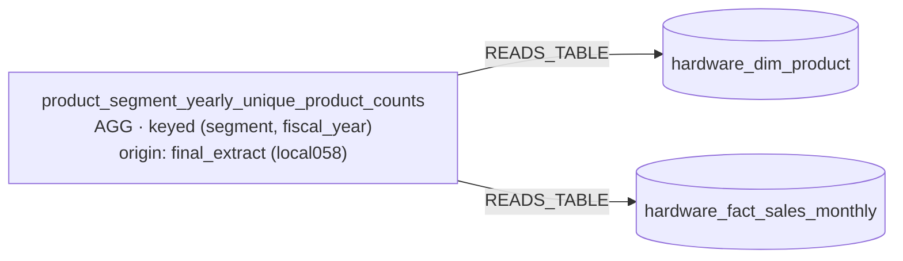
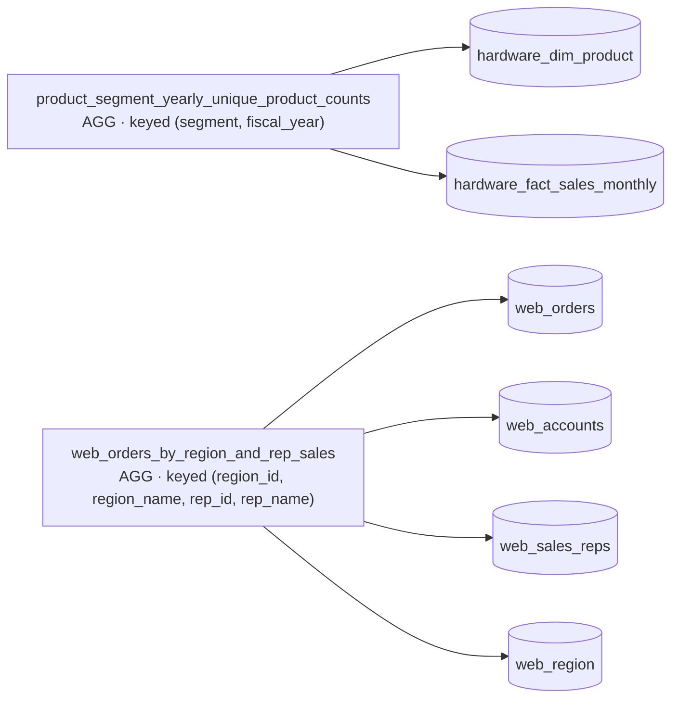
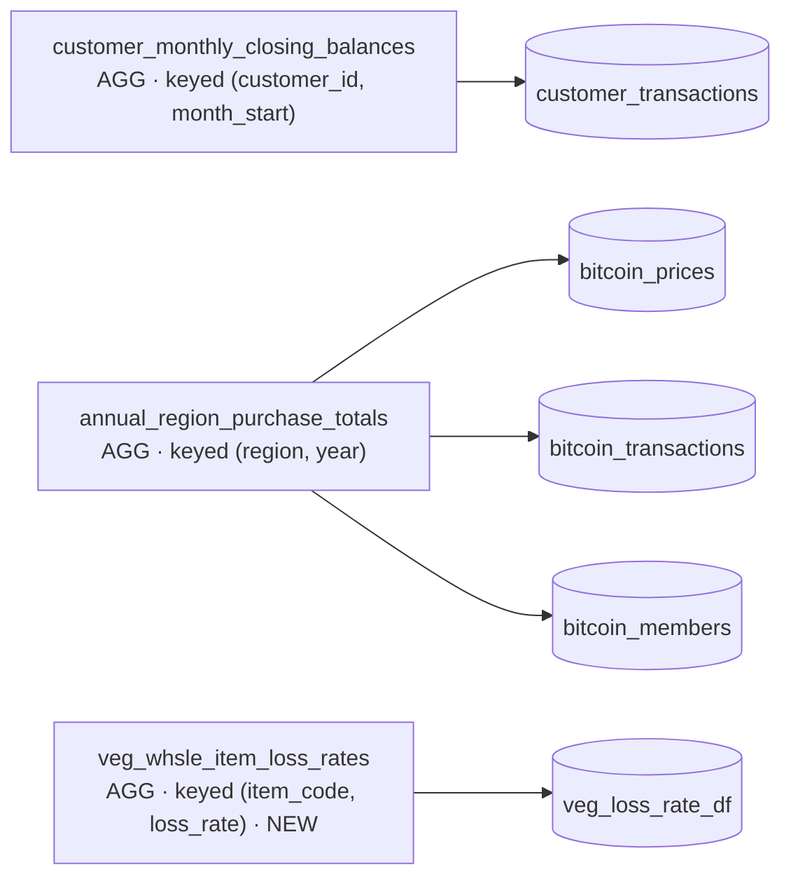
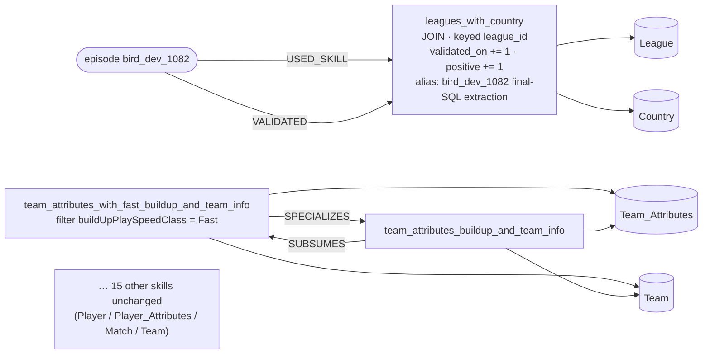

# Case studies: graph + registry with AV-SQL N×1 (gpt-5-mini)

Six questions from the run tagged `gpt5minifull_av_graph` (config A, `--architecture nx1`, gpt-5-mini, registry pipeline):

- all **5 Spider2-lite questions** this setup answered correctly (`local058`, `local059`, `local163`, `local253`, `local284`)
- **1 BIRD question** it answered correctly where no-graph N×1 did not: `bird_dev_1082`, the only such BIRD win that reused a stored skill

**Sources.** Everything below comes from the run's own records: the result rows (`runs/registry_gpt5mini_full/gpt5minifull_av_graph_*`), the episodes and ledger (`graphs/registry_gpt5mini_full/gpt5minifull_av_graph_*/{db}.episodes.jsonl`, `.ledger.jsonl`), and the final graph JSON. Nothing is re-run or reconstructed.

**One limitation.** A chunk view that was generated but later discarded is recorded by name, chunk and fate, but its SQL body was not persisted. When the execution repair rewrote the whole query, the composed pre-repair query is not stored either. Those bodies are marked *not recorded* below. When a view survived into the final SQL, its body is shown from the final SQL.

## How one question flows (N×1 with the registry)

1. **Rewrite** the question (schema-free).
2. **Split the schema into N chunks** (1,000-token budget). Each chunk is one request `chunk_view_i` (category SEL, holistic, domain = the chunk's tables).
3. **Retrieve per chunk** from a snapshot of the graph taken at question start:
   - Stage 0: index candidates (holistic requests: skills whose tables touch the chunk).
   - Stage 1: active status, complete contract, and all of the skill's tables inside the chunk.
   - Stage 2: contract check. Stage 3: similarity ≥ τ = 0.6.
   - Stage 5: the LLM verifier (majority vote).
4. **Generate on miss**: the AV-SQL agent writes one exploratory CTE for the chunk, or answers IRRELEVANT. A generated view joins the working graph as `exploratory`.
5. **Aggregate**: the planner and composer receive every chosen view (reused + generated) and write the final SELECT. It runs through the execution-repair loop (1 attempt in this run).
6. **Learn**:
   - Credit goes only to CTEs the final SQL reads unmodified.
   - Each new view is admitted only if it was executed and has a complete contract. Otherwise it is discarded.
   - A reusable relation may be extracted from the final SQL.
   - The episode and ledger are stored, and the exploratory leftovers are dropped.

The graph only gains a skill at step 6. During the question, exploratory views live in the working graph and are never retrievable.

---

## Case 1: `local058` (Spider2-lite, `education_business`). Correct (no-graph also correct)

**Question.** Can you provide a list of hardware product segments along with their unique product counts for 2020 in the output, ordered by the highest percentage increase in unique fact sales products from 2020 to 2021?

**Rewrite (step 1).** For each hardware product segment, count distinct products sold in 2020 and 2021, and order by the percentage change from 2020 to 2021, descending. Exclude segments with a zero or missing 2020 count.

**Schema chunks (step 2).** This is the first question on this database (stream position 0).

| Request | Tables in the chunk |
|---|---|
| `chunk_view_0` | StaffHours, hardware_dim_customer, hardware_dim_product, hardware_fact_pre_invoice_deductions, university_enrollment, web_orders, web_sales_reps |
| `chunk_view_1` | SalaryDataset, university_faculty, university_offering, university_student, web_accounts, web_events, web_region |
| `chunk_view_2` | hardware_fact_gross_price, hardware_fact_manufacturing_cost, hardware_fact_sales_monthly, university_course |

**Graph before the question:** empty (0 skills).

**Step by step**

| Step | What happened | Graph |
|---|---|---|
| Retrieve `chunk_view_0` | 0 index candidates: no candidate | 0 skills |
| Retrieve `chunk_view_1` | 0 index candidates: no candidate | 0 skills |
| Retrieve `chunk_view_2` | 0 index candidates: no candidate | 0 skills |
| Generate `chunk_view_0` | AV agent wrote a view over chunk 0 (body *not recorded*) | 0 skills + 1 exploratory (`chunk_view_0`) |
| Generate `chunk_view_1`, `chunk_view_2` | no view produced (judged irrelevant, or no valid SQL) | unchanged |
| Aggregate | planner + composer received **`chunk_view_0`** (generated). Nothing was reused | — |
| Execute | composed query failed: `no such column: cnt_2020` | — |
| Repair | the revisor rewrote the whole query **without** any chunk view (below) | — |
| Credit | `chunk_view_0`: selected, **not in the final SQL**, so no credit | — |
| Admission | `chunk_view_0` **discarded** (not used by the final SQL) | exploratory view dropped |
| Final-SQL extraction | relation `product_segment_yearly_unique_product_counts` extracted. Contract: AGG, keyed on `(segment, fiscal_year)` by GROUP BY. 3/3 generated tests passed. **Admitted** | **1 skill** |

**Final SQL**

```sql
WITH prod_year_counts AS (
  SELECT p.segment, s.fiscal_year, COUNT(DISTINCT p.product_code) AS unique_product_count
  FROM hardware_dim_product p
  JOIN hardware_fact_sales_monthly s ON p.product_code = s.product_code
  WHERE s.fiscal_year IN (2020, 2021)
  GROUP BY p.segment, s.fiscal_year
),
counts_pivot AS (
  SELECT segment,
         MAX(CASE WHEN fiscal_year = 2020 THEN unique_product_count END) AS cnt_2020,
         MAX(CASE WHEN fiscal_year = 2021 THEN unique_product_count END) AS cnt_2021
  FROM prod_year_counts
  GROUP BY segment
)
SELECT segment,
       COALESCE(cnt_2020, 0) AS cnt_2020,
       COALESCE(cnt_2021, 0) AS cnt_2021,
       CASE WHEN cnt_2020 IS NULL OR cnt_2020 = 0 THEN NULL
            ELSE ((cnt_2021 - cnt_2020) * 100.0) / cnt_2020 END AS percent_change
FROM counts_pivot
ORDER BY percent_change DESC
```

**Graph after the question** (`education_business`, 1 skill)



Stored body: `SELECT p.segment, s.fiscal_year, COUNT(DISTINCT p.product_code) AS unique_product_count FROM hardware_dim_product p JOIN hardware_fact_sales_monthly s ON p.product_code = s.product_code GROUP BY p.segment, s.fiscal_year`. The question's year filter was lifted out, so the skill covers every year.

**Takeaway.** The graph played no part in the answer. The correct SQL came from the repair step. The question still left behind a clean, general skill.

---

## Case 2: `local059` (Spider2-lite, `education_business`). Correct (no-graph also correct)

**Question.** For the calendar year 2021, what is the overall average quantity sold of the top three best-selling hardware products (by total quantity sold) in each division?

**Rewrite.** For each division, rank hardware products by their 2021 total quantity sold, take the top three, and report the average of their totals.

**Chunks:** same three chunks as Case 1. **Stream position 1.**

**Graph before the question:** 1 skill (`product_segment_yearly_unique_product_counts`, from Case 1).

| Step | What happened | Graph |
|---|---|---|
| Retrieve `chunk_view_0` | 1 index candidate (`product_segment_yearly_unique_product_counts`, which touches `hardware_dim_product`). **Stage 1 reject**: it also reads `hardware_fact_sales_monthly`, which is not in chunk 0 | 1 skill |
| Retrieve `chunk_view_1` | 0 index candidates | 1 skill |
| Retrieve `chunk_view_2` | same skill as candidate. **Stage 1 reject**: it reads `hardware_dim_product`, which is not in chunk 2 | 1 skill |
| Generate `chunk_view_0`, `chunk_view_2` | two AV views written (bodies *not recorded*). Chunk 1: no view | 1 skill + 2 exploratory |
| Aggregate | planner + composer received **`chunk_view_0`, `chunk_view_2`** (both generated) | — |
| Execute | composed query failed: `near "QUALIFY": syntax error` (not valid SQLite) | — |
| Repair | the revisor rewrote the whole query without the chunk views (below) | — |
| Credit | both chunk views were not in the final SQL, so no credit | — |
| Admission | both **discarded** | exploratory views dropped |
| Final-SQL extraction | candidate rejected: *incomplete contract (unknown outputs, unknown grain, validation not passed)* | **1 skill** (unchanged) |

**Final SQL**

```sql
WITH product_totals AS (
  SELECT product_code, SUM(sold_quantity) AS total_quantity_sold_2021
  FROM hardware_fact_sales_monthly
  WHERE date >= '2021-01-01' AND date <= '2021-12-31'
  GROUP BY product_code
),
ranked_products AS (
  SELECT p.product_code, p.division, p.product, pt.total_quantity_sold_2021,
         ROW_NUMBER() OVER (PARTITION BY p.division ORDER BY pt.total_quantity_sold_2021 DESC) AS rn
  FROM product_totals pt
  JOIN hardware_dim_product p ON pt.product_code = p.product_code
  WHERE p.category IS NOT NULL
),
top_three_per_div AS (SELECT * FROM ranked_products WHERE rn <= 3)
SELECT division, AVG(total_quantity_sold_2021) AS average_quantity_sold_2021_of_top_three
FROM top_three_per_div
GROUP BY division
ORDER BY division
```

**Graph after the question:** unchanged, 1 skill (same diagram as Case 1).

**Takeaway.** The only stored skill was correctly kept away from both chunks, because its tables span two chunks. The answer again came from the repair step.

---

## Case 3: `local163` (Spider2-lite, `education_business`). Correct (no-graph also correct)

**Question.** Which university faculty members' salaries are closest to the average salary for their respective ranks? Please provide the ranks, first names, last names, and salaries.

**Rewrite.** For each faculty rank, return the member(s) whose salary is closest to the rank's average salary (ties included): rank, first name, last name, salary.

**Chunks:** same three chunks. **Stream position 3.**

**Graph before the question:** 2 skills.

- `product_segment_yearly_unique_product_counts` (Case 1)
- `web_orders_by_region_and_rep_sales`: AGG, keyed `(region_id, region_name, rep_id, rep_name)`, reads `web_orders`, `web_accounts`, `web_sales_reps`, `web_region`. Extracted from the final SQL of `local114` (stream position 2).

| Step | What happened | Graph |
|---|---|---|
| Retrieve `chunk_view_0` | 2 index candidates. **Both Stage 1 rejects** (each also reads tables outside chunk 0) | 2 skills |
| Retrieve `chunk_view_1` | 1 candidate (`web_orders_by_region_and_rep_sales`). **Stage 1 reject**: `web_orders` and `web_sales_reps` are in chunk 0 | 2 skills |
| Retrieve `chunk_view_2` | 1 candidate. **Stage 1 reject** | 2 skills |
| Generate | **no chunk produced a view** (all three returned nothing usable) | 2 skills |
| Aggregate | no views, so the pipeline fell back to **direct SQL** over the full schema | — |
| Execute | ran first time, no repair | — |
| Admission | nothing to admit | — |
| Final-SQL extraction | candidate rejected: *incomplete contract (unknown grain)* | **2 skills** (unchanged) |

**Final SQL** (direct SQL)

```sql
WITH rank_avgs AS (
  SELECT FacRank AS rank, AVG(FacSalary) AS avg_salary
  FROM university_faculty GROUP BY FacRank
),
diffs AS (
  SELECT f.FacRank AS rank, f.FacFirstName AS first_name, f.FacLastName AS last_name,
         f.FacSalary AS salary, ABS(f.FacSalary - ra.avg_salary) AS abs_diff
  FROM university_faculty f JOIN rank_avgs ra ON f.FacRank = ra.rank
),
min_diffs AS (SELECT rank, MIN(abs_diff) AS min_diff FROM diffs GROUP BY rank)
SELECT d.rank, d.first_name, d.last_name, d.salary
FROM diffs d JOIN min_diffs m ON d.rank = m.rank AND d.abs_diff = m.min_diff
ORDER BY d.rank ASC
```

**Graph after the question** (`education_business`, 2 skills)



**Takeaway.** No views at all. The answer is plain direct SQL.

---

## Case 4: `local253` (Spider2-lite, `education_business`). Correct (no-graph **wrong**)

**Question.** Using a Salary Dataset where the salary values need to be cleaned by removing non-numeric characters and converting them to a numeric type, identify the top 5 companies by average salary in each of Mumbai, Pune, New Delhi and Hyderabad, then compare each company's average salary in those cities to the overall national average salary. Output: Location, Company Name, Average Salary in State, Average Salary in Country.

**Rewrite.** Clean salaries to numbers. For each of the 4 cities, take the top 5 companies by city-level average salary, and show the city average next to the national figure.

**Chunks:** same three chunks. **Stream position 4.**

**Graph before the question:** 2 skills (as after Case 3).

| Step | What happened | Graph |
|---|---|---|
| Retrieve `chunk_view_0` | 2 candidates, **both Stage 1 rejects** | 2 skills |
| Retrieve `chunk_view_1` | 1 candidate (`web_orders_by_region_and_rep_sales`), **Stage 1 reject** | 2 skills |
| Retrieve `chunk_view_2` | 1 candidate, **Stage 1 reject** | 2 skills |
| Generate `chunk_view_1` | AV view over the chunk containing `SalaryDataset` (body *not recorded*). Chunks 0 and 2: no view | 2 skills + 1 exploratory |
| Aggregate | planner + composer received **`chunk_view_1`** (generated) | — |
| Execute | composed query failed: `no such function: REGEXP_REPLACE` | — |
| Repair | the revisor rewrote the query with SQLite-only digit extraction, without the chunk view (below) | — |
| Admission | `chunk_view_1` **discarded** (not in the final SQL) | dropped |
| Final-SQL extraction | candidate rejected: *question-specific constant kept* (`5`, the top-k) | **2 skills** (unchanged) |

**Final SQL** (abridged: the digit-extraction subqueries repeat a 1–35 number table)

```sql
WITH cleaned AS (
  SELECT "CompanyName", "Location", "Salary",
         /* digits_only / clean_salary: keep only characters '0'-'9' of Salary (positions 1..35), cast to INTEGER */
         ... AS clean_salary
  FROM "SalaryDataset"
),
per_location_avg AS (
  SELECT Location, CompanyName, AVG(clean_salary) AS avg_salary_state
  FROM cleaned
  WHERE Location IN ('Mumbai', 'Pune', 'New Delhi', 'Hyderabad') AND clean_salary IS NOT NULL
  GROUP BY Location, CompanyName
),
country_avg AS (
  SELECT CompanyName, AVG(clean_salary) AS avg_salary_country
  FROM cleaned WHERE clean_salary IS NOT NULL GROUP BY CompanyName
),
ranked AS (
  SELECT p.Location, p.CompanyName, p.avg_salary_state, c.avg_salary_country,
         ROW_NUMBER() OVER (PARTITION BY p.Location ORDER BY p.avg_salary_state DESC) AS rn
  FROM per_location_avg p LEFT JOIN country_avg c ON p.CompanyName = c.CompanyName
)
SELECT Location, CompanyName AS "Company Name",
       ROUND(avg_salary_state, 2) AS "Average Salary in State",
       ROUND(avg_salary_country, 2) AS "Average Salary in Country"
FROM ranked WHERE rn <= 5
ORDER BY Location, "Average Salary in State" DESC
```

No-graph wrote a similar query, but cleaned salaries with a fixed list of `REPLACE`s plus a `GLOB` check, and compared against one national average. Its answer did not match the gold.

**Graph after the question:** unchanged, 2 skills (same diagram as Case 3).

**Takeaway.** The win over no-graph comes from a different repair outcome, not from the graph. The graph had nothing usable, and the constant check correctly blocked a top-5 relation from becoming a skill.

---

## Case 5: `local284` (Spider2-lite, `bank_sales_trading`). Correct (no-graph **wrong**)

**Question.** For veg whsle data, can you generate a summary of our items' loss rates? Include the average loss rate, and break down the count of items that are below, above, and within one standard deviation of this average.

**Rewrite.** Over distinct items, compute the average and standard deviation of the loss rate, and count items below avg−sd, within ±sd, and above avg+sd.

**Schema chunks.** Stream position 11 on this database.

| Request | Tables in the chunk |
|---|---|
| `chunk_view_0` | bitcoin_members, bitcoin_transactions, customer_nodes, customer_regions, customer_transactions, interest_metrics, shopping_cart_users, weekly_sales |
| `chunk_view_1` | bitcoin_prices, cleaned_weekly_sales, shopping_cart_events, shopping_cart_page_hierarchy, veg_txn_df |
| `chunk_view_2` | interest_map, shopping_cart_campaign_identifier, shopping_cart_event_identifier, veg_cat, veg_loss_rate_df, veg_whsle_df |

**Graph before the question:** 2 skills.

- `customer_monthly_closing_balances`: AGG, keyed `(customer_id, month_start)`, reads `customer_transactions` (from `local297`, position 2)
- `annual_region_purchase_totals`: AGG, keyed `(region, year)`, reads `bitcoin_prices`, `bitcoin_transactions`, `bitcoin_members` (from `local156`, position 9)

| Step | What happened | Graph |
|---|---|---|
| Retrieve `chunk_view_0` | 2 candidates. `annual_region_purchase_totals`: **Stage 1 reject** (`bitcoin_prices` is in chunk 1). `customer_monthly_closing_balances`: in domain, but **Stage 3 reject**, similarity 0.219 < 0.6. No candidate | 2 skills |
| Retrieve `chunk_view_1` | 1 candidate, **Stage 1 reject** | 2 skills |
| Retrieve `chunk_view_2` | 0 index candidates | 2 skills |
| Generate `chunk_view_2` | AV view over the veg tables (body *not recorded*). Chunks 0 and 1: no view | 2 skills + 1 exploratory |
| Aggregate | planner + composer received **`chunk_view_2`** (generated) | — |
| Execute | composed query failed: `near "<": syntax error` | — |
| Repair | the revisor rewrote the whole query without the chunk view (below) | — |
| Admission | `chunk_view_2` **discarded** | dropped |
| Final-SQL extraction | `veg_whsle_item_loss_rates` extracted. Contract: keyed `(item_code, loss_rate)` (DISTINCT, verified on the data, so tied to a data fingerprint). 3/3 tests passed. **Admitted** | **3 skills** |

**Final SQL**

```sql
WITH items AS (
  SELECT DISTINCT item_code, "loss_rate_%" AS loss_rate
  FROM veg_loss_rate_df
  WHERE "loss_rate_%" IS NOT NULL
),
stats AS (
  SELECT AVG(loss_rate) AS avg_loss_rate,
         CASE WHEN (AVG(loss_rate * loss_rate) - AVG(loss_rate) * AVG(loss_rate)) < 0 THEN 0
              ELSE sqrt(AVG(loss_rate * loss_rate) - AVG(loss_rate) * AVG(loss_rate)) END AS stddev_loss_rate
  FROM items
)
SELECT s.avg_loss_rate, s.stddev_loss_rate,
       SUM(CASE WHEN i.loss_rate <  (s.avg_loss_rate - s.stddev_loss_rate) THEN 1 ELSE 0 END) AS count_below_one_stddev,
       SUM(CASE WHEN i.loss_rate >= (s.avg_loss_rate - s.stddev_loss_rate)
                 AND i.loss_rate <= (s.avg_loss_rate + s.stddev_loss_rate) THEN 1 ELSE 0 END) AS count_within_one_stddev,
       SUM(CASE WHEN i.loss_rate >  (s.avg_loss_rate + s.stddev_loss_rate) THEN 1 ELSE 0 END) AS count_above_one_stddev,
       COUNT(*) AS total_item_count
FROM items i CROSS JOIN stats s
```

No-graph's query failed with `misuse of aggregate function AVG()` (an aggregate inside an aggregate in its standard-deviation expression), so it returned nothing.

**Graph after the question** (`bank_sales_trading`, 3 skills)



**Takeaway.** The answer again came from the repair step. The difference from no-graph is that its repair produced valid SQLite and no-graph's did not. The graph gained one reusable relation.

---

## Case 6: `bird_dev_1082` (BIRD, `european_football_2`). Correct (no-graph **wrong**)

**Question.** Please list the leagues from Germany. *(Evidence: Germany refers to Country.name = 'Germany'.)*

**Rewrite.** Return all leagues located in the country named 'Germany'. Required output: league names, one row per league.

**Schema chunks.** Stream position 62 of 129.

| Request | Tables in the chunk |
|---|---|
| `chunk_view_0` | Player, Player_Attributes |
| `chunk_view_1` | Country, League, Team, Team_Attributes |
| `chunk_view_2` | Match |

**Graph before the question:** 18 active skills, admitted by earlier questions (positions 2–59). There is one relation edge: `team_attributes_with_fast_buildup_and_team_info` SPECIALIZES `team_attributes_buildup_and_team_info`.

| Created at | Skill | Category | Grain | Reads |
|---|---|---|---|---|
| 2 (`1022`) | player_potential_min_cohort | AGG | id | Player_Attributes |
| 5 (`1025`) | league_season_total_goals | AGG | league_id, season | Match |
| 6 (`1026`) | home_team_season_home_loss_counts | AGG | home_team_api_id, season | Match |
| 7 (`1027`) | player_max_penalties | AGG | player_api_id | Player_Attributes |
| 8 (`1028`) | matches_with_outcomes_by_league_season | JOIN | match_id | Match, League |
| 10 (`1030`) | matches_per_league_season_draws | AGG | league_id, league_name, season | Match, League |
| 12 (`1032`) | matches_per_league | AGG | league_id | Match |
| 20 (`1040`) | player_average_heading_accuracy_by_player | AGG | player_api_id, … | Player, Player_Attributes |
| 26 (`1046`) | team_latest_attributes | JOIN | id | Team, Team_Attributes |
| 35 (`1055`) | player_max_overall_attributes | AGG | player_attributes_id | Player_Attributes |
| **36 (`1056`)** | **leagues_with_country** | **JOIN** | **league_id** | **League, Country** |
| 38 (`1058`) | player_avg_finishing_by_player | AGG | player_api_id | Player_Attributes |
| 44 (`1064`) | player_with_attributes | JOIN | player_attributes_id | Player, Player_Attributes |
| 45 (`1065`) | team_attributes_with_fast_buildup_and_team_info | JOIN | id (filter buildUpPlaySpeedClass = Fast) | Team_Attributes, Team |
| 45 (`1065`) | team_attributes_buildup_and_team_info | JOIN | id | Team_Attributes, Team |
| 49 (`1069`) | player_min_height | AGG | id | Player |
| 56 (`1076`) | player_ball_control_avg | AGG | player_api_id, player_name | Player, Player_Attributes |
| 59 (`1079`) | player_height | SEL | player_id | Player |

`leagues_with_country` was extracted from the final SQL of `bird_dev_1056` 26 questions earlier. It is a general "every league with its country" relation:

```sql
SELECT League.id AS league_id, League.name AS league_name, League.country_id AS country_id, Country.name AS country_name
FROM League JOIN Country ON League.country_id = Country.id
```

**Step by step**

| Step | What happened | Graph |
|---|---|---|
| Retrieve `chunk_view_0` (Player chunk) | 9 index candidates (player skills), all **Stage 3 rejects**: similarity 0.16–0.29 < 0.6. No candidate | 18 skills |
| Retrieve `chunk_view_1` (Country/League/Team chunk) | 6 candidates. 2 Stage 1 rejects (tables outside the chunk). `team_attributes_with_fast_buildup_and_team_info`: **Stage 2 reject**, "stored view is narrower: filter buildUpPlaySpeedClass=Fast not requested". `team_latest_attributes` (0.201) and `team_attributes_buildup_and_team_info` (0.237): Stage 3 rejects. **`leagues_with_country`: similarity 0.643 ≥ 0.6, shortlisted, LLM verifier: `verified`, mode `exact`, so REUSED** | 18 skills (the reused skill joins the question's working set) |
| Retrieve `chunk_view_2` (Match chunk) | 5 candidates. 2 Stage 1 rejects. `league_season_total_goals` (0.330), `home_team_season_home_loss_counts` (0.282), `matches_per_league` (0.427): Stage 3 rejects. No candidate | 18 skills |
| Generate `chunk_view_0` | AV view: Player LEFT JOIN Player_Attributes with ~50 columns (body in the final SQL below) | 18 skills + 1 exploratory |
| Generate `chunk_view_2` | no view produced | unchanged |
| Aggregate | planner + composer received **`leagues_with_country` (reused, exact)** and **`chunk_view_0` (generated)** | — |
| Execute | ran first time, no repair | — |
| Credit | `leagues_with_country`: retrieved, selected, included, **referenced, executed unmodified**. `chunk_view_0`: included but **not referenced** (a dead CTE) | — |
| Ablation | regenerating the chunk-1 view did not keep `leagues_with_country`'s columns, so **inconclusive**. Credit falls back to association: question correct, so outcome **positive** (`validated_on` += this question) | — |
| Admission | `chunk_view_0` **discarded** (unreferenced) | dropped |
| Final-SQL extraction | the extracted relation had the **same SQL hash** as `leagues_with_country`, so **duplicate**, merged as an alias | **18 skills** (unchanged count) |

**Final SQL**

```sql
WITH leagues_with_country AS (
  SELECT League.id AS league_id, League.name AS league_name, League.country_id AS country_id, Country.name AS country_name
  FROM League
  JOIN Country ON League.country_id = Country.id
),
chunk_view_0 AS (
  SELECT Player.id, Player.player_api_id, Player.player_name, ... /* ~50 Player / Player_Attributes columns */
  FROM Player
  LEFT JOIN Player_Attributes ON Player.player_api_id = Player_Attributes.player_api_id
)
SELECT league_name
FROM leagues_with_country
WHERE country_name = 'Germany'
ORDER BY league_name ASC
```

Result: `('Germany 1. Bundesliga',)`, which matches the gold (`SELECT t2.name FROM Country t1 JOIN League t2 ON t1.id = t2.country_id WHERE t1.name = 'Germany'`).

No-graph generated its own chunk view and wrote `SELECT League.id, League.name, League.country_id ... WHERE Country.name = 'Germany'`. That has the right league, but 3 columns where the gold has 1, so execution accuracy marks it wrong.

**Graph after the question** (`european_football_2`, 18 skills; only the relevant part shown)



**Takeaway.** This is the one case where the graph took part in the answer:

- A general relation learned 26 questions earlier was reused exactly, and the final SQL read only it.
- The answer was right where no-graph's was wrong on projection.
- The reuse plausibly helped, because the stored view exposed a clean `league_name` column. But ablation was inconclusive, so causality is not established.
- The generated Player view was dead weight, and the registry correctly gave it no credit and discarded it.

---

## What the six cases show

| Case | Graph used in the answer? | Where the final SQL came from | Effect on the graph |
|---|---|---|---|
| local058 | no (empty graph) | repair rewrite | +1 skill (final-SQL extraction) |
| local059 | no (Stage 1 rejects) | repair rewrite | none |
| local163 | no (Stage 1 rejects, no views) | direct SQL | none |
| local253 | no (Stage 1 rejects) | repair rewrite | none (constant `5` blocked) |
| local284 | no (Stage 1/3 rejects) | repair rewrite | +1 skill (final-SQL extraction) |
| bird_dev_1082 | **yes: exact reuse of `leagues_with_country`** | composer, no repair | positive evidence; duplicate merged |

- **None of the five Spider2-lite successes used the graph.** In 4 of 5, the composed query failed and the revisor rewrote it from scratch without the chunk views. The other one used direct SQL. The registry neither helped nor harmed them.
- **The table-domain check (Stage 1) did most of the rejecting on Spider2-lite.** Skills whose tables span several schema chunks can never serve a single chunk request. That is safe, but it means multi-table skills are effectively unreachable from the N×1 route on chunked schemas.
- **Every Spider2-lite skill came from final-SQL extraction, never from a chunk view**, because no chunk view ever survived into an executed final SQL.
- **The BIRD case is the intended mechanism working end to end:** learn a general relation, retrieve it in the right chunk, verify, reuse it exactly, credit it only because the final SQL executed it, and merge the duplicate instead of storing it twice.
