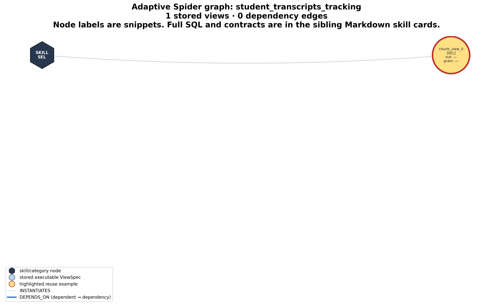
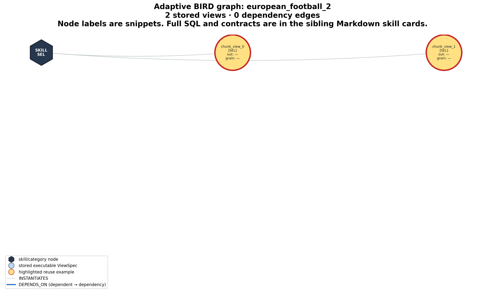

# Current architecture benchmark: semantic adaptive routing

> Fresh run on 30 September 2026. This is the active report. The retired focused-holistic arm is deliberately excluded from the interface, run set, and comparison tables.

## Bottom line

Adaptive is **not universally more accurate** in this sample. It ties AV-SQL without a graph overall at **20/60 (33.3%)**, while using **22.2% fewer tokens** and generating **19 instead of 106 CTEs**. The tie hides a strong dataset interaction: adaptive gains four answers on Spider and loses four on BIRD. All four methods fail all 20 selected Spider2-lite questions.

The good news is that semantic routing works very well on the selected Spider stream: adaptive reaches **17/20 (85%)**, compared with 13/20 for AV-SQL without graph, while using 78.0% fewer tokens. The bad news is that moderate BIRD questions still enter aggressive AV graph reuse, producing 13 non-trivial negative-reuse failures.

## Experimental setup

- Spider: first 20 questions from `student_transcripts_tracking`.
- BIRD: first 20 questions from `european_football_2`.
- Spider2-lite: all 15 `bank_sales_trading` plus all 5 `education_business` questions.
- Model: local Ollama `gemma3:4b`, temperature 0.
- Common settings: 1,000-token schema chunks, maximum 3 subgoals, 1 view-validation attempt, 1 SQL repair, 1 self-consistency pass, no value linking, retrieval threshold 0.6.
- Each graph-enabled dataset run starts with an empty graph and grows it sequentially question by question. Graphs are not shared between architectures or datasets.
- `N` is the number of schema chunks and `M` is the number of dependency subgoals. Dependency mode aligns every one of the `M` subgoals against all `N` chunks.

## Accuracy by dataset

| Method | Spider | BIRD | Spider2-lite | Overall |
|---|---:|---:|---:|---:|
| AV-SQL, no graph | 13/20 (65.0%) | 7/20 (35.0%) | 0/20 (0.0%) | 20/60 (33.3%) |
| AV-SQL + graph | 12/20 (60.0%) | 2/20 (10.0%) | 0/20 (0.0%) | 14/60 (23.3%) |
| Dependency N×M + graph | 11/20 (55.0%) | 3/20 (15.0%) | 0/20 (0.0%) | 14/60 (23.3%) |
| Adaptive + graph | 17/20 (85.0%) | 3/20 (15.0%) | 0/20 (0.0%) | 20/60 (33.3%) |

## Pooled cost, graph, and reuse results

`Measured time` is the sum of per-question pipeline timers in the result rows. It excludes dataset preparation and model loading. The Spider2-lite AV-graph run also had one 240-second question timeout, which is recorded separately and is not represented faithfully by that row timer.

| Method | Correct | Tokens | LLM/embed calls | CTEs generated | Questions with reuse | Negative reuse | Saved graph views | Measured time |
|---|---:|---:|---:|---:|---:|---:|---:|---:|
| AV-SQL, no graph | 20/60 | 904,664 | 375 | 106 | 0/60 | 0 (0 raw) | n/a | 410.58s |
| AV-SQL + graph | 14/60 | 659,198 | 290 | 10 | 54/60 | 33 (41 raw) | 11 | 294.66s |
| Dependency N×M + graph | 14/60 | 1,185,452 | 736 | 48 | 3/60 | 1 (3 raw) | 48 | 547.76s |
| Adaptive + graph | 20/60 | 704,243 | 466 | 19 | 19/60 | 15 (15 raw) | 19 | 393.94s |

Relative to AV-SQL without graph:

- AV-SQL + graph saves 27.1% of tokens and 90.6% of CTE generation, but loses 6 correct answers and incurs 33 non-trivial negative reuses.
- Dependency N×M also scores 14/60, uses 31.0% more tokens, and nearly doubles calls. Alignment alone accounts for 532,996 tokens and 384 calls.
- Adaptive preserves the same 20/60 accuracy, saves 22.2% of tokens and 82.1% of CTE generation, but makes 24.3% more calls because classification and alignment add many short calls.

## Detailed dataset metrics

| Dataset | Method | Correct | Tokens | Calls | Generated | Reuse-hit questions | Non-trivial negative reuse | Mean seconds/question |
|---|---|---:|---:|---:|---:|---:|---:|---:|
| Spider | AV-SQL, no graph | 13/20 | 168,122 | 108 | 35 | 0 | 0 | 3.51 |
| Spider | AV-SQL + graph | 12/20 | 121,253 | 92 | 3 | 18 | 0 | 2.95 |
| Spider | Dependency N×M + graph | 11/20 | 139,229 | 147 | 14 | 2 | 1 | 3.85 |
| Spider | Adaptive + graph | 17/20 | 37,024 | 68 | 1 | 1 | 0 | 1.86 |
| BIRD | AV-SQL, no graph | 7/20 | 410,544 | 133 | 44 | 0 | 0 | 7.13 |
| BIRD | AV-SQL + graph | 2/20 | 297,126 | 97 | 2 | 19 | 17 | 4.54 |
| BIRD | Dependency N×M + graph | 3/20 | 621,275 | 274 | 12 | 1 | 0 | 9.54 |
| BIRD | Adaptive + graph | 3/20 | 246,038 | 104 | 2 | 16 | 13 | 4.67 |
| Spider2-lite | AV-SQL, no graph | 0/20 | 325,998 | 134 | 27 | 0 | 0 | 9.88 |
| Spider2-lite | AV-SQL + graph | 0/20 | 240,819 | 101 | 5 | 17 | 16 | 7.24 |
| Spider2-lite | Dependency N×M + graph | 0/20 | 424,948 | 315 | 22 | 0 | 0 | 14.00 |
| Spider2-lite | Adaptive + graph | 0/20 | 421,181 | 294 | 16 | 2 | 2 | 13.17 |

## What adaptive actually selected

| Dataset | Route | Questions | Correct | Generated CTEs | Reuse-hit questions | Negative reuse | Tokens |
|---|---|---:|---:|---:|---:|---:|---:|
| Spider | Moderate → AV N×1 + graph | 2 | 2 (100.0%) | 1 | 1 | 0 | 17,746 |
| Spider | Easy → direct SQL | 18 | 15 (83.3%) | 0 | 0 | 0 | 19,278 |
| BIRD | Moderate → AV N×1 + graph | 17 | 3 (17.6%) | 2 | 16 | 13 | 240,543 |
| BIRD | Easy → direct SQL | 3 | 0 (0.0%) | 0 | 0 | 0 | 5,495 |
| Spider2-lite | Moderate → AV N×1 + graph | 4 | 0 (0.0%) | 3 | 2 | 2 | 62,673 |
| Spider2-lite | Hard → dependency N×M + graph | 16 | 0 (0.0%) | 13 | 0 | 0 | 358,508 |

Interpretation:

- Spider benefited because 18/20 questions bypassed views and graph retrieval. Direct SQL was correct on 15/18, and both moderate questions were correct.
- BIRD routed 17/20 questions to moderate AV+graph. Reusing two early views broadly over the stream saved cost but caused 13 negative-reuse failures. No question was classified hard.
- Spider2-lite routed 16/20 questions to hard N×M and 4/20 to moderate AV. This routing looks structurally plausible, but the local 4B model produced no correct final answers.

## Paired adaptive wins and losses

A win means adaptive is correct and the compared method is wrong on the same question. A loss is the reverse. A tie includes both-correct and both-wrong cases.

| Compared with | Spider W/L/T | BIRD W/L/T | Spider2-lite W/L/T | Overall W/L/T |
|---|---:|---:|---:|---:|
| AV-SQL, no graph | 5/1/14 | 0/4/16 | 0/0/20 | 5/5/50 |
| AV-SQL + graph | 7/2/11 | 2/1/17 | 0/0/20 | 9/3/48 |
| Dependency N×M + graph | 7/1/12 | 2/2/16 | 0/0/20 | 9/3/48 |

The most important paired comparison is adaptive versus AV-SQL without graph:

- Adaptive Spider wins: `spider_dev_509`, `spider_dev_510`, `spider_dev_513`, `spider_dev_519`, `spider_dev_520`.
- Adaptive Spider loss: `spider_dev_517`.
- Adaptive BIRD losses: `bird_dev_1020`, `bird_dev_1036`, `bird_dev_1038`, `bird_dev_1039`.
- Spider2-lite has 20 both-wrong ties. Overall this is 5 wins, 5 losses, and 50 ties.

## Why adaptive beats AV-SQL without a graph on Spider

The five paired Spider wins are all **routing wins**, not graph-reuse wins. Adaptive classified each question as easy and sent it directly to SQL generation. The direct path selected a small relevant schema slice and produced no CTE. AV-SQL without a graph processed both schema chunks, generated one or two exploratory CTEs, and then composed an unnecessary outer query. In four cases, the extra planning changed the requested counting grain. In the address case, it removed a column and later tried to filter on that missing column.

The saved result rows do not contain the model's hidden rewrite text. Therefore, the descriptions below report only persisted evidence: question, route, selected schema, generated SQL, graph state, execution result, and scorer outcome. They do not invent a rewrite that was not logged.

### Spider paired-win summary

| Question | Adaptive route | Adaptive result | AV-SQL result | Main difference |
|---|---|---:|---:|---|
| `spider_dev_509` | easy → direct SQL | 15, correct | 1, wrong | AV-SQL counted the one-row aggregate CTE instead of the `Courses` rows |
| `spider_dev_510` | easy → direct SQL | 15, correct | 1, wrong | Same nested-aggregate error on the paraphrased question |
| `spider_dev_513` | easy → direct SQL | `148`, correct | empty, wrong | AV-SQL filtered `city` after its CTE had projected only `zip_postcode` |
| `spider_dev_519` | easy → direct SQL | 3, correct | 15, wrong | Adaptive counted distinct degree names while AV-SQL counted program IDs |
| `spider_dev_520` | easy → direct SQL | 3, correct | 15, wrong | Same name-versus-instance grain error on the paraphrased question |

### Relevant Spider schema

The five cases need only three base tables:

```text
Courses(course_id PK, course_name, course_description, other_details)
Addresses(address_id PK, line_1, line_2, line_3, city, zip_postcode, ...)
Degree_Programs(degree_program_id PK, department_id FK, degree_summary_name, degree_summary_description, ...)
```

The database has 15 rows in `Courses`, 15 degree-program rows, and 3 distinct values of `Degree_Programs.degree_summary_name`.

### `spider_dev_509`: total listed courses

Question: “How many courses in total are listed?”

Adaptive selected the `Courses` table, used 894 tokens, generated no view, and executed:

```sql
SELECT COUNT(*) FROM Courses
```

This returned `15`, exactly matching the gold query. AV-SQL used 7,125 tokens and generated two chunk views. Its final query was:

```sql
WITH chunk_view_0 AS (
  SELECT COUNT(c.course_id)
  FROM Courses AS c
),
chunk_view_1 AS (
  SELECT COUNT(DISTINCT Student_Enrolment_Courses.course_id) AS total_courses
  FROM Student_Enrolment_Courses
)
SELECT COUNT(*)
FROM chunk_view_0
```

`chunk_view_0` already contains one aggregate row with the value 15. The outer `COUNT(*)` counts that row and returns `1`. The second CTE is unused.

### `spider_dev_510`: paraphrase of the course-count question

Question: “How many courses are there?”

Adaptive again used the direct route, consumed 887 tokens, generated no view, and returned `15` with:

```sql
SELECT COUNT(*) FROM Courses
```

AV-SQL used 7,135 tokens. It generated one CTE that counted `Courses` and a second CTE that counted enrolled course IDs, then repeated the same outer-row counting mistake:

```sql
WITH chunk_view_0 AS (
  SELECT COUNT(c.course_id)
  FROM Courses AS c
),
chunk_view_1 AS (
  SELECT COUNT(DISTINCT scc.course_id)
  FROM Student_Enrolment_Courses AS scc
  JOIN Courses AS c ON scc.course_id = c.course_id
)
SELECT COUNT(*) AS total_courses
FROM chunk_view_0
```

The result was again `1`. This paired paraphrase shows that the improvement is repeatable within this stream and comes from avoiding redundant aggregate composition.

### `spider_dev_513`: Port Chelsea postcode

Question: “What is the zip code of the address in the city Port Chelsea?”

Adaptive selected the `Addresses` table, used 1,137 tokens, and executed:

```sql
SELECT zip_postcode
FROM Addresses
WHERE city = "Port Chelsea"
```

SQLite returned `148`, matching the gold result. AV-SQL used 7,335 tokens and produced:

```sql
WITH chunk_view_0 AS (
  SELECT T1.zip_postcode
  FROM Addresses AS T1
  JOIN Students AS T2 ON T1.address_id = T2.current_address_id
  WHERE T1.city = 'Port Chelsea'
),
chunk_view_1 AS (
  SELECT T.other_details
  FROM Transcripts AS T
  WHERE T.other_details LIKE '%Port Chelsea%'
)
SELECT zip_postcode
FROM chunk_view_0
WHERE city = 'Port Chelsea'
```

The first CTE already applies the city filter but exposes only `zip_postcode`. The outer query applies `city` again even though `city` is not in the CTE output. The execution-repair path converted this into an executable but empty result, so the answer did not match `148`. The transcript CTE is unrelated and unused.

### `spider_dev_519`: distinct degree names

Question: “How many different degree names are offered?”

Adaptive used 1,055 tokens and correctly preserved the requested semantic unit, which is a degree name:

```sql
SELECT COUNT(DISTINCT degree_summary_name)
FROM Degree_Programs
```

The result was `3`. AV-SQL used 7,632 tokens. Although its generated CTE contained the correct expression, its final planner replaced that expression with a count of program instances:

```sql
WITH chunk_view_0 AS (
  SELECT COUNT(DISTINCT dp.degree_summary_name)
  FROM Degree_Programs AS dp
)
SELECT COUNT(DISTINCT degree_program_id)
FROM Degree_Programs
```

The final result was `15`. The failure is not table selection. It is a loss of the name-level grain during final composition.

### `spider_dev_520`: paraphrase of the distinct-degree question

Question: “How many different degrees are offered?”

Adaptive used 1,019 tokens and again returned `3` by counting `degree_summary_name`. AV-SQL used 7,298 tokens and returned `15`:

```sql
WITH chunk_view_0 AS (
  SELECT COUNT(DISTINCT degree_program_id)
  FROM Degree_Programs
),
chunk_view_1 AS (
  SELECT COUNT(DISTINCT Degree_Programs.degree_program_id)
  FROM Degree_Programs
)
SELECT COUNT(DISTINCT degree_program_id)
FROM Degree_Programs
```

Both AV-SQL chunk views chose the physical program identifier rather than the semantic degree name. Adaptive's easy path avoided that drift.

### Spider graph state during these wins

The graph was empty for `spider_dev_509`, `spider_dev_510`, and `spider_dev_513`. It gained one view at `spider_dev_515`, which asks for the department offering the most degrees. That view was reused successfully only for the near-identical `spider_dev_516`. By the time `spider_dev_519` and `spider_dev_520` ran, the graph contained the view, but both questions took the direct route and did not query or reuse it. Therefore, none of the five paired wins can be credited to graph reuse.

The one stored Spider view is a `SEL` node over `Departments` and `Degree_Programs`. It has no dependency edges:

```sql
SELECT
  Departments.department_name,
  Departments.department_id
FROM Departments
WHERE Departments.department_id IN (
  SELECT department_id
  FROM Degree_Programs
  GROUP BY department_id
  ORDER BY COUNT(*) DESC
  LIMIT 1
)
```



Artifacts: [graph figure](figures/semantic20_adaptive_spider_skill_graph.png), [full skill card](graphs/current/semantic20_adaptive_graph_spider_A_SkiewSQL/student_transcripts_tracking.md), [canonical graph JSON](graphs/current/semantic20_adaptive_graph_spider_A_SkiewSQL/student_transcripts_tracking.json), [adaptive rows](runs/current/semantic20_adaptive_graph_spider_A_SkiewSQL.json), and [AV-SQL rows](runs/current/semantic20_av_nograph_spider_B_Baseline_AVSQL.json).

## BIRD cases where AV-SQL without a graph is correct and adaptive is wrong

There are four such cases. `bird_dev_1020` is an **easy-route failure before any graph exists**. The remaining three are **moderate-route failures after graph retrieval**. In each of those three cases, adaptive retrieves the same irrelevant `Player_Attributes` count view once for each of the three schema chunks. The stored view is included as a dead CTE in the final SQL, but its larger effect is that it replaces fresh chunk-specific exploration, leaving the planner without grounded views for the tables actually needed by the question.

### BIRD reverse-flip summary

| Question | Adaptive route | Graph retrieval | Adaptive outcome | AV-SQL outcome |
|---|---|---|---|---|
| `bird_dev_1020` | easy → direct SQL | none, graph empty | orders `Player.height`, wrong player ID | orders `Player_Attributes.overall_rating`, correct |
| `bird_dev_1036` | moderate → AV + graph | `chunk_view_0` × 3 at 0.760 | empty team list | correct above-average 2012 teams |
| `bird_dev_1038` | moderate → AV + graph | `chunk_view_0` × 3 at 0.742 | sums XML-like `goal` and returns league IDs | sums home and away goals and returns league names |
| `bird_dev_1039` | moderate → AV + graph | `chunk_view_0` × 3 at 0.802 | averages `shot_power`, returns 63.0 | averages `long_shots`, returns 61.5714 |

### How the BIRD graph was constructed

The first three BIRD questions were classified easy and created no views. `bird_dev_1023` was the first moderate question. It asked for the number of players with overall rating between 60 and 65 whose attacking work rate is low. With an empty graph, adaptive generated two executable `SEL` views and saved both:

```sql
-- chunk_view_0, source Player_Attributes
SELECT COUNT(id)
FROM Player_Attributes
WHERE overall_rating BETWEEN 60 AND 65
  AND attacking_work_rate = 'low'
```

```sql
-- chunk_view_1, source Team_Attributes
SELECT COUNT(T.team_api_id)
FROM Team_Attributes AS T
WHERE T.buildUpPlaySpeed >= 60
  AND T.buildUpPlaySpeed < 65
  AND T.buildUpPlaySpeedClass = 'Balanced'
```

Both nodes are categorized as `SEL`, both read base tables directly, and there are no `DEPENDS_ON` edges. More importantly, both saved contracts have empty `output_columns`, empty `grain`, and empty `semantic_filters`. `chunk_view_1` also inherited the player-count description even though its SQL reads team attributes. These weak and inconsistent contracts allowed embedding similarity alone to dominate retrieval.

After `bird_dev_1023`, `chunk_view_0` was retrieved for all three schema chunks on 16 of the remaining 16 moderate questions. The final graph records three question-level successes under `validated_on` and ten failures under `counter_examples`. These labels describe whether the complete final query happened to score correctly. They do not prove that the saved view contributed causally, because the reused CTE is often unreferenced by the final answer query.



Artifacts: [graph figure](figures/semantic20_adaptive_bird_skill_graph.png), [full skill cards](graphs/current/semantic20_adaptive_graph_bird_A_SkiewSQL/european_football_2.md), [canonical graph JSON](graphs/current/semantic20_adaptive_graph_bird_A_SkiewSQL/european_football_2.json), [adaptive rows](runs/current/semantic20_adaptive_graph_bird_A_SkiewSQL.json), and [AV-SQL rows](runs/current/semantic20_av_nograph_bird_B_Baseline_AVSQL.json).

### `bird_dev_1020`: highest overall rating

Question: “Which player has the highest overall rating? Indicate the player's api id.” External evidence explicitly defines the target as `MAX(overall_rating)`.

Relevant schema:

```text
Player(player_api_id, player_name, birthday, height, ...)
Player_Attributes(player_api_id FK, date, overall_rating, potential, ...)
```

Adaptive classified the question as easy, selected the wrong table and ranking column, and used 1,158 tokens:

```sql
SELECT player_api_id
FROM Player
ORDER BY height DESC
LIMIT 1
```

This returned player `148325`. The correct player is `30981`. Because the graph was empty and the route was direct, this loss is unrelated to reuse. AV-SQL used 21,056 tokens, examined all three chunks, found `overall_rating` in `Player_Attributes`, and returned the correct ID:

```sql
SELECT T1.player_api_id
FROM Player_Attributes AS T1
ORDER BY T1.overall_rating DESC
LIMIT 1
```

### `bird_dev_1036`: above-average build-up passing in 2012

Question: “List the long name of teams with above-average build-up play passing in 2012.”

Relevant schema:

```text
Team(team_api_id, team_long_name, ...)
Team_Attributes(team_api_id FK, date, buildUpPlayPassing, ...)
```

Adaptive routed to AV + graph, used 12,448 tokens, and retrieved `chunk_view_0` for all three chunks at cosine similarity 0.760. Its answer query compared a per-team row count with the global average passing score:

```sql
SELECT T.team_long_name
FROM Team_Attributes AS TA
JOIN Team AS T ON TA.team_api_id = T.team_api_id
WHERE strftime('%Y', TA.date) = '2012'
  AND TA.buildUpPlayPassing IS NOT NULL
  AND (
    SELECT COUNT(*)
    FROM Team_Attributes
    WHERE team_api_id = TA.team_api_id
      AND buildUpPlayPassing IS NOT NULL
  ) > (
    SELECT AVG(buildUpPlayPassing)
    FROM Team_Attributes
  )
```

It returned no rows. The irrelevant reused player-count CTE was present in the full prediction but was not referenced by this `SELECT`. AV-SQL without a graph used 22,661 tokens and generated a fresh relevant view. Its final query compared each team's average passing score with the 2012 global average and matched the gold result:

```sql
SELECT T.team_long_name
FROM Team AS T
JOIN Team_Attributes AS TA ON T.team_api_id = TA.team_api_id
WHERE strftime('%Y', TA.date) = '2012'
GROUP BY T.team_long_name
HAVING AVG(TA.buildUpPlayPassing) > (
  SELECT AVG(buildUpPlayPassing)
  FROM Team_Attributes
  WHERE strftime('%Y', date) = '2012'
)
```

The evidence supports a retrieval-related failure, but not the narrower claim that executing the reused CTE directly corrupted the result. The CTE was dead. The likely harm is that reuse displaced fresh schema exploration that AV-SQL needed to formulate the correct aggregate.

### `bird_dev_1038`: five leagues with the fewest total goals

Question: “List the top 5 leagues in ascending order of the number of goals made in all seasons combined.” External evidence defines total goals as home goals plus away goals.

Relevant schema:

```text
League(id, name, ...)
Match(league_id FK, home_team_goal, away_team_goal, goal TEXT, ...)
```

Adaptive used 11,943 tokens and retrieved `chunk_view_0` three times at similarity 0.742. Its answer query returned IDs rather than league names and summed the `goal` text field:

```sql
SELECT league_id, SUM(goal) AS total_goals
FROM Match
GROUP BY league_id
ORDER BY total_goals ASC
LIMIT 5
```

The result began with `(1, NULL)`, `(17642, NULL)`, and `(1729, 0.0)`, which does not match the requested output. AV-SQL used 22,137 tokens and correctly joined `League`, summed both numeric score columns, and returned the exact five gold rows:

```sql
SELECT
  L.name,
  SUM(M.home_team_goal + M.away_team_goal) AS total_goals
FROM Match AS M
JOIN League AS L ON M.league_id = L.id
GROUP BY L.id, L.name
ORDER BY total_goals ASC
LIMIT 5
```

The correct ordered result is Switzerland Super League with 4,166 goals, Poland Ekstraklasa with 4,656, Scotland Premier League with 4,804, Belgium Jupiler League with 4,841, and Portugal Liga ZON Sagres with 5,201.

### `bird_dev_1039`: Ahmed Samir Farag's average long shots

Question: “Find the average number of long-shot done by Ahmed Samir Farag.” External evidence defines the value from `long_shots` across the player's attribute records.

Relevant schema:

```text
Player(player_api_id, player_name, ...)
Player_Attributes(player_api_id FK, shot_power, long_shots, ...)
```

Adaptive used 11,259 tokens and retrieved `chunk_view_0` three times at similarity 0.802. The final answer selected the related but wrong attribute and added an unsupported preferred-foot filter:

```sql
SELECT CAST(AVG(shot_power) AS REAL)
FROM Player_Attributes
JOIN Player
  ON Player.player_fifa_api_id = Player_Attributes.player_fifa_api_id
WHERE Player.player_name = 'Ahmed Samir Farag'
  AND Player_Attributes.preferred_foot = 'right'
```

It returned `63.0`. AV-SQL used 16,463 tokens and correctly averaged `long_shots` over the player's records:

```sql
SELECT AVG(PA.long_shots)
FROM Player_Attributes AS PA
JOIN Player AS P ON PA.player_api_id = P.player_api_id
WHERE P.player_name = 'Ahmed Samir Farag'
```

This returned `61.57142857142857`, matching the gold query. As in the other graph cases, the irrelevant retrieved CTE was dead in the final SQL. Its measurable role was replacing fresh chunk views, not contributing rows to the final aggregate.

### What these examples demonstrate

The Spider gain validates the easy-question bypass. Simple single-table questions often become less reliable when forced through per-chunk view generation and a second aggregation planner. The BIRD failures show that the current adaptive classifier and graph guard are not yet safe enough. Easy routing can omit the required table, and moderate routing can accept a semantically unrelated view when its stored contract lacks output, grain, and filter information. A stronger version should reject empty contracts, retrieve at most once per distinct request rather than once per chunk, require source-table or output overlap, and distinguish question-level success from evidence that a reused view was actually referenced by the final SQL.

## Token/call breakdown by stage

| Method | Stage | Tokens | Calls |
|---|---|---:|---:|
| AV-SQL, no graph | `av_view` | 283,830 | 160 |
| AV-SQL, no graph | `compose` | 227,106 | 56 |
| AV-SQL, no graph | `plan` | 208,210 | 56 |
| AV-SQL, no graph | `revise` | 146,292 | 38 |
| AV-SQL, no graph | `rewrite` | 21,871 | 60 |
| AV-SQL, no graph | `direct` | 17,355 | 5 |
| AV-SQL + graph | `compose` | 244,933 | 59 |
| AV-SQL + graph | `plan` | 224,090 | 59 |
| AV-SQL + graph | `revise` | 137,158 | 35 |
| AV-SQL + graph | `av_view` | 22,650 | 14 |
| AV-SQL + graph | `rewrite` | 21,847 | 60 |
| AV-SQL + graph | `embed` | 5,030 | 62 |
| AV-SQL + graph | `direct` | 3,490 | 1 |
| Dependency N×M + graph | `align` | 532,996 | 384 |
| Dependency N×M + graph | `generate` | 240,168 | 109 |
| Dependency N×M + graph | `decompose` | 103,274 | 60 |
| Dependency N×M + graph | `compose` | 84,670 | 38 |
| Dependency N×M + graph | `direct` | 78,639 | 22 |
| Dependency N×M + graph | `plan` | 72,430 | 38 |
| Dependency N×M + graph | `revise` | 51,391 | 20 |
| Dependency N×M + graph | `rewrite` | 21,844 | 60 |
| Dependency N×M + graph | `embed` | 40 | 5 |
| Adaptive + graph | `align` | 175,728 | 144 |
| Adaptive + graph | `compose` | 133,609 | 31 |
| Adaptive + graph | `plan` | 121,822 | 31 |
| Adaptive + graph | `revise` | 66,338 | 21 |
| Adaptive + graph | `generate` | 57,039 | 39 |
| Adaptive + graph | `direct` | 40,068 | 30 |
| Adaptive + graph | `difficulty` | 36,019 | 60 |
| Adaptive + graph | `decompose` | 31,026 | 16 |
| Adaptive + graph | `rewrite` | 21,858 | 60 |
| Adaptive + graph | `av_view` | 19,068 | 11 |
| Adaptive + graph | `embed` | 1,668 | 23 |

## Conclusions

1. **Keep adaptive as the research direction, but do not claim a universal accuracy win.** This run supports an efficiency claim at equal pooled accuracy and a strong Spider result.
2. **Do not enable aggressive graph reuse by default for moderate questions yet.** BIRD's high reuse rate is mostly harmful. Compatibility needs stronger grain/filter/output checks or a verifier before a saved view can replace fresh AV generation.
3. **Easy-question bypass is the clearest success.** It removes unnecessary views, graph lookups, and planner calls while improving Spider accuracy.
4. **Dependency N×M needs cheaper alignment.** It is safer than broad AV reuse here, but its 384 alignment calls and 532,996 alignment tokens do not produce an accuracy gain.
5. **Spider2-lite remains unresolved.** Because all methods score zero, this subset cannot distinguish architectures with the current local model. A stronger model and error-focused prompt/schema debugging are required before drawing architectural conclusions from it.

## Reproduction and artifacts

Run all four arms with:

```bash
bash skiewsql/results_real/benchmarks/architecture/run_current_benchmark.sh
python skiewsql/results_real/benchmarks/architecture/analyze_current_benchmark.py
```

Raw per-question outputs and the machine-readable aggregate are under `runs/current/`. grown graphs are under `graphs/current/`. Per-process logs are under `logs/current/`.

## Validity limits

This is a controlled architecture test, not a publication-grade benchmark: each named dataset sample covers only one or two databases, uses a small local model, and contains 20 questions. Results may also vary across local inference runs despite temperature 0. The next confirmation should cover more database domains and use a stronger fixed model.
