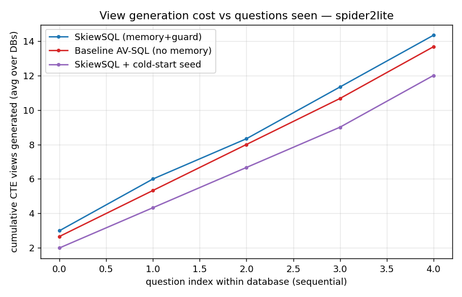
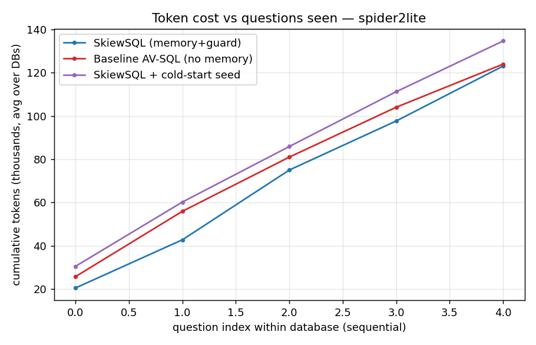

# SkiewSQL results — spider2lite (tag=exp1seed)

Databases: ['bank_sales_trading', 'IPL', 'city_legislation']  |  questions/config: 15

| metric | SkiewSQL (memory+guard) | SkiewSQL + cold-start seed | Baseline AV-SQL (no memory) |
|---|---|---|---|
| Execution accuracy | 33.3% | 40.0% | 26.7% |
| Cold-start EX (1st Q/db) | 0.0% | 0.0% | 0.0% |
| Warm EX (later Qs) | 41.7% | 50.0% | 33.3% |
| Exact view-reuse rate | 0.0% | 8.9% | 0.0% |
| Seed view-reuse rate | 0.0% | 8.9% | 0.0% |
| % Q with no new CTE | 0.0% | 0.0% | 0.0% |
| Total CTE generations | 43 | 36 | 41 |
| Avg new views / Q | 2.867 | 2.4 | 2.733 |
| REAL total tokens | 369254 | 404050 | 371985 |
| Negative-reuse count | 0 | 1 | 0 |
| Avg secs / Q | 49.71 | 50.45 | 67.51 |

**S · cold-start seed vs B · baseline:**
- CTE generations: 36 vs 41 → 5 fewer (12.2%)
- Real tokens: 404,050 vs 371,985 → 32,065 MORE (8.6%)
- Accuracy: 40.0% vs 26.7%; reuse 8.9% (seed 8.9%) vs 0.0%.

**S · cold-start seed vs A · empty-start SkiewSQL:**
- CTE generations: 36 vs 43 → 7 fewer (16.3%)
- Real tokens: 404,050 vs 369,254 → 34,796 MORE (9.4%)
- Accuracy: 40.0% vs 33.3%; reuse 8.9% (seed 8.9%) vs 0.0%.

**A · SkiewSQL vs B · baseline:**
- CTE generations: 43 vs 41 → 2 MORE (4.9%)
- Real tokens: 369,254 vs 371,985 → 2,731 fewer (0.7%)
- Accuracy: 33.3% vs 26.7%; reuse 0.0% (seed 0.0%) vs 0.0%.

### Real token breakdown by pipeline stage
| stage | SkiewSQL (memory+guard) | SkiewSQL + cold-start seed | Baseline AV-SQL (no memory) |
|---|---|---|---|
| rewrite | 38,129 (10%) | 38,255 (9%) | 38,435 (10%) |
| propose | 55,013 (15%) | 54,861 (14%) | 55,571 (15%) |
| generate | 180,709 (49%) | 215,603 (53%) | 181,471 (49%) |
| plan | 18,303 (5%) | 18,000 (4%) | 18,682 (5%) |
| compose | 24,480 (7%) | 26,190 (6%) | 26,052 (7%) |
| revise | 19,688 (5%) | 19,991 (5%) | 20,870 (6%) |
| semantic | 32,919 (9%) | 30,756 (8%) | 30,904 (8%) |
| embed | 13 (0%) | 394 (0%) | 0 (0%) |

