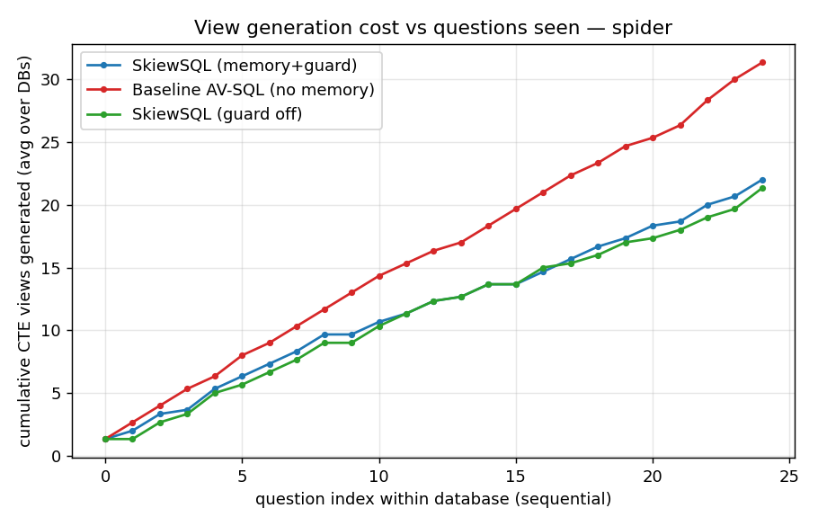
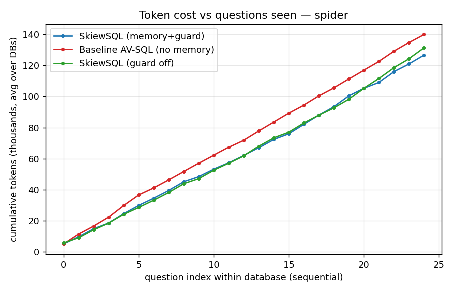

# SkiewSQL results — spider (tag=exp1)

Databases: ['world_1', 'dog_kennels', 'student_transcripts_tracking']  |  questions/config: 75

| metric | SkiewSQL (memory+guard) | Baseline AV-SQL (no memory) | SkiewSQL (guard off) |
|---|---|---|---|
| Execution accuracy | 76.0% | 80.0% | 80.0% |
| Cold-start EX (1st Q/db) | 100.0% | 100.0% | 100.0% |
| Warm EX (later Qs) | 75.0% | 79.2% | 79.2% |
| Exact view-reuse rate | 32.4% | 0.0% | 31.7% |
| % Q with no new CTE | 25.3% | 4.0% | 32.0% |
| Total CTE generations | 66 | 94 | 64 |
| Avg new views / Q | 0.88 | 1.253 | 0.853 |
| REAL total tokens | 379874 | 419708 | 393898 |
| Negative-reuse count | 6 | 0 | 4 |
| Avg secs / Q | 6.83 | 7.98 | 8.39 |

- **CTE generations**: 66 (SkiewSQL) vs 94 (baseline) → 28 fewer (29.8% reduction).
- **Real tokens**: 379,874 vs 419,708 → 39,834 fewer (9.5% reduction).
- **Accuracy**: 76.0% (SkiewSQL) vs 80.0% (baseline).

 
