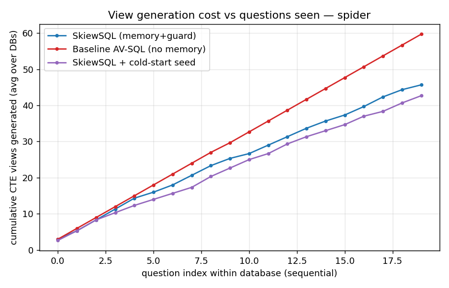
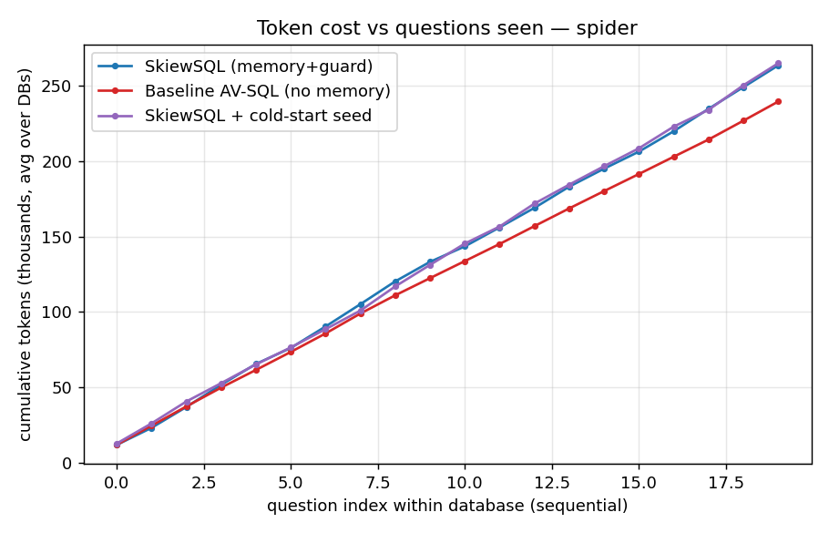

# SkiewSQL results — spider (tag=exp1seed)

Databases: ['world_1', 'dog_kennels', 'student_transcripts_tracking']  |  questions/config: 60

| metric | SkiewSQL (memory+guard) | SkiewSQL + cold-start seed | Baseline AV-SQL (no memory) |
|---|---|---|---|
| Execution accuracy | 73.3% | 71.7% | 70.0% |
| Cold-start EX (1st Q/db) | 66.7% | 66.7% | 66.7% |
| Warm EX (later Qs) | 73.7% | 71.9% | 70.2% |
| Exact view-reuse rate | 22.5% | 28.5% | 0.0% |
| Seed view-reuse rate | 0.0% | 10.6% | 0.0% |
| % Q with no new CTE | 1.7% | 8.3% | 0.0% |
| Total CTE generations | 137 | 128 | 179 |
| Avg new views / Q | 2.283 | 2.133 | 2.983 |
| REAL total tokens | 790391 | 794659 | 718447 |
| Negative-reuse count | 7 | 9 | 0 |
| Avg secs / Q | 22.33 | 19.39 | 19.0 |

**S · cold-start seed vs B · baseline:**
- CTE generations: 128 vs 179 → 51 fewer (28.5%)
- Real tokens: 794,659 vs 718,447 → 76,212 MORE (10.6%)
- Accuracy: 71.7% vs 70.0%. Reuse 28.5% (seed 10.6%) vs 0.0%.

**S · cold-start seed vs A · empty-start SkiewSQL:**
- CTE generations: 128 vs 137 → 9 fewer (6.6%)
- Real tokens: 794,659 vs 790,391 → 4,268 MORE (0.5%)
- Accuracy: 71.7% vs 73.3%. Reuse 28.5% (seed 10.6%) vs 22.5%.

**A · SkiewSQL vs B · baseline:**
- CTE generations: 137 vs 179 → 42 fewer (23.5%)
- Real tokens: 790,391 vs 718,447 → 71,944 MORE (10.0%)
- Accuracy: 73.3% vs 70.0%. Reuse 22.5% (seed 0.0%) vs 0.0%.

### Real token breakdown by pipeline stage
| stage | SkiewSQL (memory+guard) | SkiewSQL + cold-start seed | Baseline AV-SQL (no memory) |
|---|---|---|---|
| rewrite | 80,356 (10%) | 80,138 (10%) | 80,383 (11%) |
| propose | 145,763 (18%) | 145,217 (18%) | 145,768 (20%) |
| generate | 360,540 (46%) | 367,838 (46%) | 299,730 (42%) |
| plan | 59,440 (8%) | 59,259 (7%) | 57,999 (8%) |
| compose | 65,790 (8%) | 65,664 (8%) | 64,343 (9%) |
| revise | 4,949 (1%) | 6,597 (1%) | 6,572 (1%) |
| semantic | 71,607 (9%) | 66,958 (8%) | 63,652 (9%) |
| embed | 1,946 (0%) | 2,988 (0%) | 0 (0%) |

 
