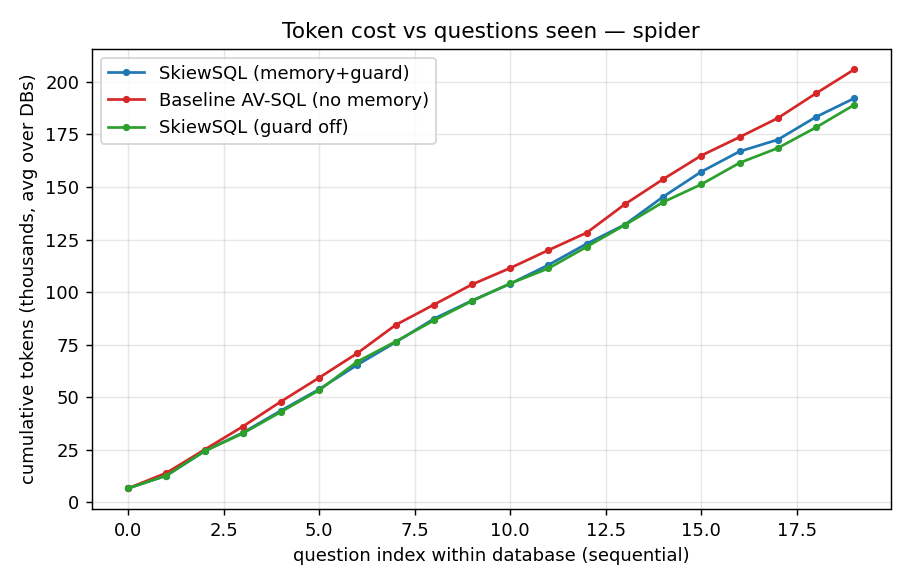

# SkiewSQL results — spider (tag=v2)

Databases: ['world_1', 'dog_kennels', 'student_transcripts_tracking']  |  questions/config: 60

| metric | SkiewSQL (memory+guard) | Baseline AV-SQL (no memory) | SkiewSQL (guard off) |
|---|---|---|---|
| Execution accuracy | 83.3% | 81.7% | 81.7% |
| Cold-start EX (1st Q/db) | 100.0% | 100.0% | 100.0% |
| Warm EX (later Qs) | 82.5% | 80.7% | 80.7% |
| Exact view-reuse rate | 31.5% | 0.0% | 30.5% |
| % Q with no new CTE | 26.7% | 0.0% | 26.7% |
| Total CTE generations | 75 | 122 | 80 |
| Avg new views / Q | 1.25 | 2.033 | 1.333 |
| REAL total tokens | 576661 | 617828 | 567258 |
| Negative-reuse count | 4 | 0 | 4 |
| Avg secs / Q | 14.38 | 14.81 | 12.79 |

- **CTE generations**: 75 (SkiewSQL) vs 122 (baseline) → 47 fewer (38.5% reduction).
- **Real tokens**: 576,661 vs 617,828 → 41,167 fewer (6.7% reduction).
- **Accuracy**: 83.3% (SkiewSQL) vs 81.7% (baseline).

### Real token breakdown by pipeline stage
| stage | SkiewSQL (memory+guard) | Baseline AV-SQL (no memory) | SkiewSQL (guard off) |
|---|---|---|---|
| rewrite | 77,167 (13%) | 77,163 (12%) | 77,175 (14%) |
| propose | 121,191 (21%) | 121,648 (20%) | 121,032 (21%) |
| generate | 205,808 (36%) | 249,268 (40%) | 204,213 (36%) |
| plan | 49,996 (9%) | 48,571 (8%) | 45,933 (8%) |
| compose | 55,760 (10%) | 54,444 (9%) | 51,682 (9%) |
| revise | 12,297 (2%) | 14,785 (2%) | 14,565 (3%) |
| semantic | 53,742 (9%) | 51,949 (8%) | 50,356 (9%) |
| direct | 0 (0%) | 0 (0%) | 1,527 (0%) |
| embed | 700 (0%) | 0 (0%) | 775 (0%) |

 
