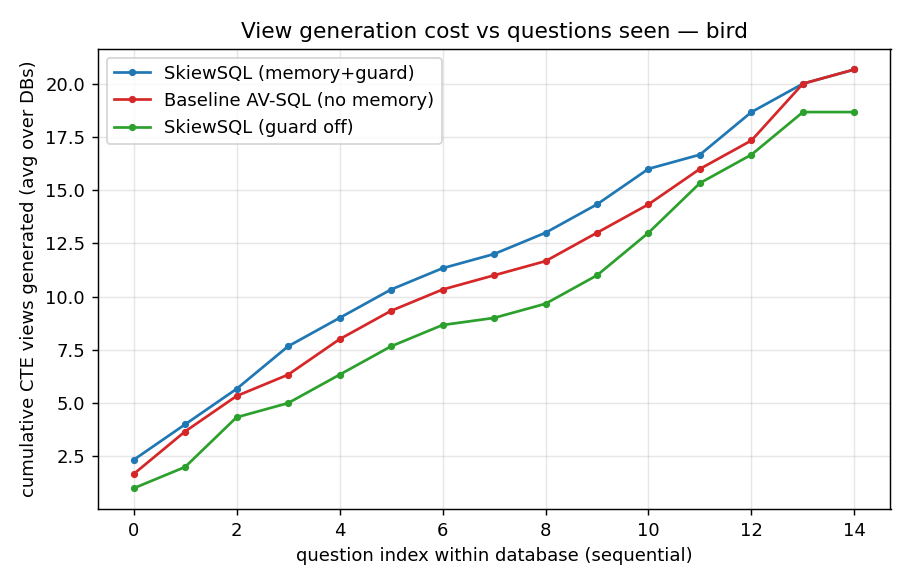
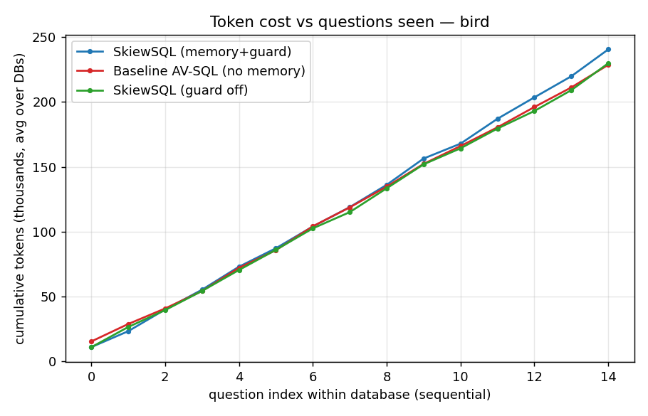

# SkiewSQL results — bird (tag=v2)

Databases: ['financial', 'superhero', 'formula_1']  |  questions/config: 45

| metric | SkiewSQL (memory+guard) | Baseline AV-SQL (no memory) | SkiewSQL (guard off) |
|---|---|---|---|
| Execution accuracy | 46.7% | 46.7% | 46.7% |
| Cold-start EX (1st Q/db) | 66.7% | 66.7% | 66.7% |
| Warm EX (later Qs) | 45.2% | 45.2% | 45.2% |
| Exact view-reuse rate | 8.3% | 0.0% | 8.6% |
| % Q with no new CTE | 13.3% | 26.7% | 24.4% |
| Total CTE generations | 62 | 62 | 56 |
| Avg new views / Q | 1.378 | 1.378 | 1.244 |
| REAL total tokens | 721625 | 685978 | 689508 |
| Negative-reuse count | 4 | 0 | 4 |
| Avg secs / Q | 19.09 | 21.68 | 21.31 |

- **CTE generations**: 62 (SkiewSQL) vs 62 (baseline) → 0 fewer (0.0% reduction).
- **Real tokens**: 721,625 vs 685,978 → -35,647 fewer (-5.2% reduction).
- **Accuracy**: 46.7% (SkiewSQL) vs 46.7% (baseline).

### Real token breakdown by pipeline stage
| stage | SkiewSQL (memory+guard) | Baseline AV-SQL (no memory) | SkiewSQL (guard off) |
|---|---|---|---|
| rewrite | 72,095 (10%) | 72,231 (11%) | 72,125 (10%) |
| propose | 106,109 (15%) | 106,280 (15%) | 105,919 (15%) |
| generate | 391,545 (54%) | 366,079 (53%) | 370,960 (54%) |
| plan | 31,913 (4%) | 26,337 (4%) | 28,382 (4%) |
| compose | 37,539 (5%) | 31,024 (5%) | 33,712 (5%) |
| revise | 32,872 (5%) | 24,979 (4%) | 26,568 (4%) |
| semantic | 40,810 (6%) | 39,252 (6%) | 39,516 (6%) |
| direct | 8,554 (1%) | 19,787 (3%) | 12,077 (2%) |
| embed | 188 (0%) | 9 (0%) | 249 (0%) |

